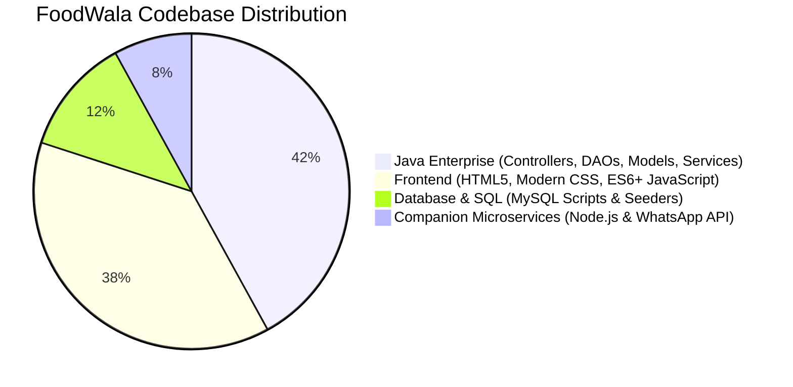

# 02. FoodWala - Complete Technology Stack Audit

## 1. Technological Reality of the FoodWala Codebase

Following a rigorous code inspection of `D:\FoodWala_Eclipse_Project`, this document provides an honest, factual, and deeply detailed audit of every technology, runtime, library, and framework actually used in the project.

---

## 2. Backend Technology Stack (Java Enterprise)

### 2.1 Language: Java 17 LTS (Java Standard Edition 17)
- **Why Java 17**: Provides modern Java language features (enhanced `switch` expressions, text blocks, pattern matching for `instanceof`, modern `java.net.http.HttpClient`), combined with long-term stability, deterministic garbage collection (G1GC), and enterprise scalability.
- **Java 17 Features in FoodWala**:
  - `java.net.http.HttpClient` in `RazorpayService.java` for asynchronous non-blocking HTTP calls to payment APIs.
  - Multi-line text blocks in `UserDAOImpl.java` and `RestaurantDAOImpl.java` for clean SQL queries.
  - `try-with-resources` ensuring zero connection leaks when managing `java.sql.Connection` and `PreparedStatement`.

### 2.2 Enterprise Web Framework: Jakarta EE Servlets (Servlet 5.0 / 6.0)
- **Framework Type**: Standard Java Enterprise Web Application (Dynamic Web Project 5.0).
- **Core Annotation**: `@WebServlet` used across 23 controllers to map HTTP endpoints without bulky XML routing tables.
- **Key Classes**:
  - `jakarta.servlet.http.HttpServlet`: Base abstract class inherited by all controllers.
  - `jakarta.servlet.http.HttpServletRequest`: Inbound HTTP request metadata, parameters, and sessions.
  - `jakarta.servlet.http.HttpServletResponse`: Outbound HTTP status codes, JSON streams, and redirect headers.
  - `jakarta.servlet.http.HttpSession`: Server-side state holder for authenticated customer sessions.

### 2.3 Web & Application Server: Apache Tomcat 11.0.26
- **Server Type**: High-performance HTTP server and Servlet/JSP container.
- **Location on Disk**: `D:\apache-tomcat-11.0.26`.
- **Deployment Structure**: Deploys the application context `/FoodWala` by mapping `src/main/webapp` as the document root and `build/classes` into `/WEB-INF/classes`.

### 2.4 Persistence & Database Connectivity: JDBC (Java Database Connectivity)
- **Driver**: `com.mysql.cj.jdbc.Driver` (MySQL Connector/J version `26.7.0` located in `src/main/webapp/WEB-INF/lib/`).
- **Connection Engine**: `DBConnection.java` (`com.tap.util.DBConnection`).
  - Implements dynamic environment variable and system property resolution (`DB_HOST`, `DB_PORT`, `DB_NAME`, `DB_USER`, `DB_PASSWORD`).
  - Fallback defaults configure local MySQL (`localhost:3306/fudwala`).
  - Enforces `useSSL=false&allowPublicKeyRetrieval=true&serverTimezone=UTC`.
- **Query Mechanism**: 100% parameterized `java.sql.PreparedStatement` protecting against SQL injection attacks.

### 2.5 Cryptography & Security Libraries
- **Bouncy Castle Crypto Provider** (`bcprov-jdk18on-1.78.1.jar` - 8.3 MB):
  - Used in `PasswordUtil.java` for **Argon2id** password hashing (`org.bouncycastle.crypto.generators.Argon2BytesGenerator`).
- **jBCrypt** (`jbcrypt-0.4.jar` - 17 KB):
  - Used in `PasswordUtil.java` for industry-standard **BCrypt** password salting and verification (`org.mindrot.jbcrypt.BCrypt`).
- **Java Cryptography Architecture (JCA)** (`javax.crypto.Mac`):
  - Used in `RazorpayService.java` for **HMAC-SHA256** digital signature calculation.

---

## 3. Database Technology Stack

### 3.1 Relational Database Management System: MySQL 8.0+ / 9.x
- **Database Name**: `fudwala`.
- **Character Set**: `utf8mb4` with collation `utf8mb4_unicode_ci` (full emoji, multi-language culinary names, and international character support).
- **Storage Engine**: `InnoDB` (enforcing ACID compliance, row-level locking, and foreign key integrity).
- **Scale**: 22 normalized tables, 105 restaurants, 416 categories, 756 food items.

---

## 4. Frontend Technology Stack

```mermaid
graph LR
    subgraph Structure["HTML5 / Semantic Views"]
        HTMLPages["15+ Responsive Pages<br/>(home.html, menu.html, cart.html, etc.)"]
        JSPViews["13 JSP Views<br/>(cart.jsp, checkout.jsp, etc.)"]
    end

    subgraph Styling["CSS3 / Modern Design"]
        BootstrapCSS["Bootstrap 5.3 CSS<br/>(Grid system & responsive utilities)"]
        CustomCSS["Custom Theme & Animations<br/>(style.css & component CSS)"]
        Icons["Bootstrap Icons font pack"]
    end

    subgraph Logic["Vanilla ES6+ JavaScript"]
        AppCore["js/app.min.js<br/>(State management, DOM rendering)"]
        Adapters["js/adapters/mockAdapter.js<br/>(API client with offline fallback)"]
        Assistance["js/help-assistance.js<br/>(WhatsApp AI drawer & live support)"]
        Maps["Leaflet 1.9 JS & CSS<br/>(Live valet tracking)"]
        Firebase["Firebase Auth Compat SDK<br/>(Google OAuth)"]
    end

    Structure --> Styling
    Styling --> Logic
```

### 4.1 HTML5 & Server-Side JSP
- **Semantic Structure**: Modern HTML5 (`<header>`, `<nav>`, `<main>`, `<section>`, `<article>`, `<footer>`).
- **JSP Dynamic Rendering**: Legacy enterprise views using Java Standard Tag Library (JSTL) and scriptlets for server-side evaluation.

### 4.2 Styling & Visual Design
- **Bootstrap 5.3.x**: 12-column mobile-first grid, flexbox layout utilities, modals, toasts, offcanvas drawers.
- **Bootstrap Icons**: Vector icon system for shopping carts, star ratings, delivery bikes, and arrows.
- **Custom CSS3 Variables**: Color palette (`--primary: #fc8019` FoodWala orange, `--secondary: #282c3f`, `--success: #60b246`).

### 4.3 Client-Side Logic & External SDKs
- **ES6+ Vanilla JavaScript**: Clean, framework-free architecture maximizing loading speeds (0ms framework boot time).
- **Leaflet Maps (v1.9.4)**: Open-source interactive map engine rendering valet route polylines and restaurant pins without expensive Google Maps API billing.
- **Firebase Authentication Compat (v10.8)**: Client-side Google Identity SDK for 1-click Google Sign-In.

---

## 5. Companion Microservices & Automation Stack

### 5.1 Node.js Express Microservice (`server/`)
- **Runtime**: Node.js v22/v24.
- **Framework**: Express.js 5.0 (REST API and Meta Webhook Receiver on port 5000).
- **Database Driver**: `mysql2/promise` (connection pooling with MySQL `fudwala`).
- **AI Engine**: Gemini 2.5 Flash with local circuit-breaker fallback for instant offline order intelligence.

### 5.2 Network & Edge Ingress: Cloudflare Zero-Trust Tunnel
- **Tool**: `cloudflared.exe` tunnel daemon (`scripts/tunnel.js`).
- **Purpose**: Creates an encrypted, live HTTPS public ingress (`https://*.trycloudflare.com`) exposing local port 5000 directly to Meta WhatsApp Cloud API webhooks without opening router firewall ports.

---

## 6. Build, Development, and IDE Configuration

### 6.1 Eclipse IDE (Eclipse IDE for Enterprise Java and Web Developers)
- **Version**: Eclipse 2025-06 / 2024-12 (`jee-2025-06`).
- **Configuration Files**:
  - [`.project`](file:///D:/FoodWala_Eclipse_Project/.project): Eclipse project definition with `javabuilder`, `facetbuilder`, and `validationbuilder`.
  - [`.classpath`](file:///D:/FoodWala_Eclipse_Project/.classpath): Configures `src/main/java` and `src/main/resources`, standard JavaSE-17 runtime, Tomcat 11 target container, and Web App Libraries container.
  - [`.settings/org.eclipse.wst.common.component`](file:///D:/FoodWala_Eclipse_Project/.settings/org.eclipse.wst.common.component): Component deploy mappings for web modules.
  - [`.settings/org.eclipse.core.resources.prefs`](file:///D:/FoodWala_Eclipse_Project/.settings/org.eclipse.core.resources.prefs): Project-wide `UTF-8` character encoding.

### 6.2 Version Control & Hosting
- **VCS**: Git (clean commit history, strict branch conventions on `main`).
- **Remote Hosting**: GitHub repository (`https://github.com/vishnu6301382491-dev/Foodwala.git`).
- **Static Frontend Hosting**: GitHub Pages (`https://vishnu6301382491-dev.github.io/Foodwala/`).

---

## 7. Architectural Comparison: Actual Stack vs Spring Boot Alternative

When presenting to clients or senior technical interviewers, use this precise comparison table:

| Architectural Dimension | FoodWala Actual Implementation | Spring Boot Enterprise Alternative |
| :--- | :--- | :--- |
| **Application Packaging** | Java Dynamic Web Project (.war / exploded directory) deployed to Apache Tomcat 11. | Standalone executable Spring Boot Uber-JAR (`java -jar app.jar`) with embedded Tomcat. |
| **HTTP Routing** | Jakarta `@WebServlet({"/path"})` extending `HttpServlet`. | Spring MVC `@RestController` and `@GetMapping` / `@PostMapping`. |
| **Dependency Injection** | Manual instantiation / Factory Pattern (`new RestaurantDAOImpl()`). | Inversion of Control (IoC) with `@Autowired` or Constructor Injection. |
| **Object Relational Mapping**| Data Access Object (DAO) pattern using direct JDBC `PreparedStatement` & `ResultSet` mapping. | Spring Data JPA + Hibernate ORM using `@Entity`, `@Table`, and `JpaRepository<T, ID>`. |
| **Configuration** | Java properties files (`sms.properties`), System Properties, and Environment Variables. | `application.properties` or `application.yml` with `@Value` and `@ConfigurationProperties`. |
| **Security Layer** | Custom Filter (`CORSFilter.java`) + `PasswordUtil.java` (Argon2id / BCrypt) + `HttpSession`. | Spring Security filter chain (`SecurityFilterChain`), `DaoAuthenticationProvider`, and `BCryptPasswordEncoder`. |
| **Transaction Management** | Explicit JDBC transactions (`connection.setAutoCommit(false)`, `commit()`, `rollback()`). | Declarative Spring `@Transactional` annotation managing AOP transaction proxies. |

> [!TIP]
> **Interview Power Answer**:  
> *"FoodWala was deliberately developed on raw enterprise Java foundations (Jakarta Servlets, JDBC, and the DAO pattern). This gave us zero-overhead runtime performance, total control over SQL query execution plans, and a deep understanding of Java enterprise web internals without relying on framework magic. However, the system's design adheres strictly to the Controller-Service-Repository separation of concerns, making it 100% modular and ready for immediate migration to Spring Boot."*
