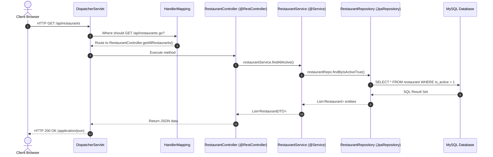

# 03. Spring Boot Architecture & FoodWala Conversion Blueprint

## 1. Introduction to Spring Boot & Enterprise Architecture

While FoodWala is natively built using Jakarta EE Servlets and JDBC DAOs, modern enterprise Java teams frequently build microservices using **Spring Boot**. 

This document explains every fundamental Spring Boot concept in clear, professional English and provides an exact **side-by-side architectural blueprint** showing how every FoodWala component maps into the Spring Boot ecosystem.

---

## 2. Core Spring Boot Concepts Explained

### 2.1 What is Spring Framework?
The Spring Framework is an open-source, enterprise Java application framework that provides comprehensive infrastructure support. Its core philosophy is **Inversion of Control (IoC)**, enabling developers to write loosely coupled code by delegating object creation and lifecycle management to the container.

### 2.2 What is Spring Boot?
Spring Boot is an opinionated extension of the Spring Framework designed to eliminate boilerplate configuration ("Convention over Configuration"). It provides:
1. **Embedded Web Servers**: Tomcat, Jetty, or Undertow packaged directly inside the JAR file (no external WAR deployment required).
2. **Starter POMs**: Pre-packaged Maven/Gradle dependencies (e.g. `spring-boot-starter-web`, `spring-boot-starter-data-jpa`).
3. **Auto-Configuration**: Automatically configures database connections, JSON serializers (Jackson), and security filters based on classpath dependencies.
4. **Production Metrics**: Ready-to-use health checks and telemetry via Spring Boot Actuator.

---

## 3. Fundamental Architecture Concepts

### 3.1 Inversion of Control (IoC)
- **Traditional Java**: You create dependencies manually using the `new` keyword:
  ```java
  // Traditional tightly-coupled instantiation
  RestaurantDAO restaurantDAO = new RestaurantDAOImpl();
  ```
- **Inversion of Control**: You surrender control of object instantiation to the Spring Container:
  ```java
  // Spring IoC: Spring creates and injects the instance
  @Autowired
  private RestaurantDAO restaurantDAO;
  ```

### 3.2 Dependency Injection (DI)
Dependency Injection is the design pattern used to implement IoC. Instead of a class looking up or creating its dependencies, dependencies are "injected" from the outside.
- **Constructor Injection (Best Practice)**:
  ```java
  @Service
  public class RestaurantService {
      private final RestaurantRepository restaurantRepo;

      // Injected automatically by Spring via constructor
      public RestaurantService(RestaurantRepository restaurantRepo) {
          this.restaurantRepo = restaurantRepo;
      }
  }
  ```

### 3.3 The Spring ApplicationContext & Spring Beans
- **Spring Bean**: Any Java object managed, instantiated, assembled, and configured by the Spring IoC Container.
- **ApplicationContext**: The actual runtime engine representing the IoC container. It scans classes marked with `@Component`, `@Service`, `@Repository`, or `@Controller`, instantiates them as singleton beans, and wires them together.

### 3.4 DispatcherServlet (The Front Controller Pattern)
In a Spring Boot Web application, **all** incoming HTTP requests pass through a single master servlet called the `DispatcherServlet`.
1. Customer sends `GET /api/restaurants`.
2. `DispatcherServlet` intercepts the request.
3. It queries the `HandlerMapping` to find which controller method matches `/api/restaurants`.
4. It calls `HandlerAdapter` to execute `RestaurantController.getAllRestaurants()`.
5. It serializes the returned Java objects into JSON using the Jackson `HttpMessageConverter`.
6. It sends the HTTP 200 JSON response back to the client.



---

## 4. Layered Architecture: Controller vs Service vs Repository

FoodWala follows a strict 3-tier architectural separation of concerns:

```
[ HTTP Request ]
       │
       ▼
┌─────────────────────────────────────────────────────────────┐
│ 1. CONTROLLER LAYER (@RestController / @WebServlet)         │
│ - Accepts HTTP requests (GET, POST, PUT, DELETE).           │
│ - Validates user input and extracts headers/cookies.       │
│ - Calls Service layer methods.                              │
│ - Never writes raw SQL; never executes core business math.  │
└─────────────────────────────────────────────────────────────┘
       │
       ▼
┌─────────────────────────────────────────────────────────────┐
│ 2. SERVICE LAYER (@Service / Service Classes)               │
│ - Executes core business logic and workflows.               │
│ - Calculates GST, delivery fees, and coupon discounts.      │
│ - Manages transactional boundaries (@Transactional).        │
│ - Coordinates third-party APIs (Razorpay, SMS, WhatsApp).   │
└─────────────────────────────────────────────────────────────┘
       │
       ▼
┌─────────────────────────────────────────────────────────────┐
│ 3. REPOSITORY / DAO LAYER (@Repository / DAO Interfaces)    │
│ - Communicates directly with the database.                  │
│ - Executes SQL queries (JDBC) or JPQL queries (Hibernate).  │
│ - Maps SQL result rows into Java objects / entities.        │
│ - Performs CRUD operations (Create, Read, Update, Delete).  │
└─────────────────────────────────────────────────────────────┘
       │
       ▼
[ MySQL Database ('fudwala') ]
```

---

## 5. Complete Spring Boot Annotation Reference

| Annotation | Purpose & Layer | FoodWala Usage / Blueprint Equivalent |
| :--- | :--- | :--- |
| `@SpringBootApplication` | Bootstrap entry point combining `@Configuration`, `@EnableAutoConfiguration`, and `@ComponentScan`. | Main class `FoodWalaApplication.java`. |
| `@RestController` | Marks a class as a REST API controller; automatically applies `@ResponseBody` to all methods. | Equivalent to `RestaurantApiController.java`. |
| `@Controller` | Marks a class as an MVC controller returning HTML/JSP view names. | Equivalent to `HomeController.java`. |
| `@Service` | Marks a business logic component in the service layer. | Equivalent to `OrderService.java` or `RazorpayService.java`. |
| `@Repository` | Marks a database access component; enables automatic SQL exception translation. | Equivalent to `UserDAOImpl.java` or `OrderDAOImpl.java`. |
| `@GetMapping` | Shortcut for `@RequestMapping(method = RequestMethod.GET)`. | Handlers for `/api/restaurants`, `/api/menu`. |
| `@PostMapping` | Shortcut for `@RequestMapping(method = RequestMethod.POST)`. | Handlers for `/api/auth/login`, `/api/checkout`. |
| `@PathVariable` | Extracts dynamic path variables from the URL (e.g. `/api/menu/{restaurantId}`). | Extracting specific restaurant IDs. |
| `@RequestParam` | Extracts URL query parameters (e.g. `/api/search?q=biryani`). | Extracting search keywords and cuisine filters. |
| `@RequestBody` | Deserializes the JSON HTTP request body into a Java DTO object. | Receiving customer registration JSON payloads. |
| `@Autowired` | Injects dependencies automatically by matching bean types. | Injecting `UserDAO` into `LoginController`. |
| `@Transactional` | Manages atomic database transactions (auto rollback on uncaught `RuntimeException`). | Wrapping multi-step order and payment persistence. |

---

## 6. Concrete Code Blueprint: Converting FoodWala to Spring Boot

### Step 1: Model &rarr; JPA Entity
**Actual FoodWala (`com.tap.model.Restaurant.java`)**:
```java
public class Restaurant {
    private int restaurantId;
    private String name;
    private String cuisineType;
    private double rating;
    // Getters and Setters...
}
```

**Spring Boot JPA Entity Equivalent**:
```java
package com.foodwala.entity;

import jakarta.persistence.*;
import lombok.*;

@Entity
@Table(name = "restaurant")
@Getter @Setter @NoArgsConstructor @AllArgsConstructor
public class RestaurantEntity {

    @Id
    @GeneratedValue(strategy = GenerationType.IDENTITY)
    @Column(name = "restaurant_id")
    private Integer restaurantId;

    @Column(name = "name", length = 150, nullable = false)
    private String name;

    @Column(name = "cuisine_type", length = 100)
    private String cuisineType;

    @Column(name = "rating")
    private Double rating;

    @Column(name = "is_active")
    private Boolean isActive;
}
```

---

### Step 2: DAO &rarr; Spring Data JPA Repository
**Actual FoodWala (`com.tap.dao.RestaurantDAO.java`)**:
```java
public interface RestaurantDAO {
    List<Restaurant> getAllRestaurants();
    Restaurant getRestaurant(int id);
}
```

**Spring Boot JPA Repository Equivalent**:
```java
package com.foodwala.repository;

import com.foodwala.entity.RestaurantEntity;
import org.springframework.data.jpa.repository.JpaRepository;
import org.springframework.stereotype.Repository;
import java.util.List;

@Repository
public interface RestaurantRepository extends JpaRepository<RestaurantEntity, Integer> {
    // Derived query generated automatically by Spring Data JPA!
    List<RestaurantEntity> findByIsActiveTrue();
    List<RestaurantEntity> findByCuisineTypeIgnoreCase(String cuisine);
    List<RestaurantEntity> findByNameContainingIgnoreCase(String keyword);
}
```
*(Notice: No SQL code or PreparedStatement needed—Spring Data JPA writes the queries automatically!)*

---

### Step 3: Servlet Controller &rarr; Spring Boot `@RestController`
**Actual FoodWala (`com.tap.controller.RestaurantApiController.java`)**:
```java
@WebServlet("/api/restaurants")
public class RestaurantApiController extends HttpServlet {
    private RestaurantDAO restaurantDAO = new RestaurantDAOImpl();

    protected void doGet(HttpServletRequest req, HttpServletResponse res) throws IOException {
        res.setContentType("application/json");
        List<Restaurant> list = restaurantDAO.getAllRestaurants();
        res.getWriter().write(JsonUtil.restaurantListToJson(list));
    }
}
```

**Spring Boot REST Controller Equivalent**:
```java
package com.foodwala.controller;

import com.foodwala.entity.RestaurantEntity;
import com.foodwala.service.RestaurantService;
import org.springframework.http.ResponseEntity;
import org.springframework.web.bind.annotation.*;
import java.util.List;

@RestController
@RequestMapping("/api/restaurants")
@CrossOrigin(origins = "*") // Handles CORS automatically
public class RestaurantRestController {

    private final RestaurantService restaurantService;

    // Constructor Injection
    public RestaurantRestController(RestaurantService restaurantService) {
        this.restaurantService = restaurantService;
    }

    @GetMapping
    public ResponseEntity<List<RestaurantEntity>> getRestaurants(
            @RequestParam(required = false) String cuisine) {
        if (cuisine != null) {
            return ResponseEntity.ok(restaurantService.getByCuisine(cuisine));
        }
        return ResponseEntity.ok(restaurantService.getAllActive());
    }

    @GetMapping("/{id}")
    public ResponseEntity<RestaurantEntity> getRestaurantById(@PathVariable Integer id) {
        return restaurantService.getById(id)
                .map(ResponseEntity::ok)
                .orElse(ResponseEntity.notFound().build());
    }
}
```

---

## 7. How to Explain This in an Interview

> [!TIP]
> **Client / Interview Talking Points**:
> 1. *"FoodWala was constructed on raw Java Enterprise Servlets and JDBC DAOs. Why? Because mastering the underlying mechanics—how `HttpServlet` processes GET/POST, how `PreparedStatement` binds query parameters, and how `HttpSession` preserves client state—is the essential foundation of any senior Java engineer."*
> 2. *"Because we adhered to strict architectural separation of concerns (Model-View-Controller and Service-DAO layers), migrating this application to Spring Boot requires zero business logic rewrite. We simply annotate models with `@Entity`, extend `JpaRepository`, and replace `@WebServlet` with `@RestController`."*
