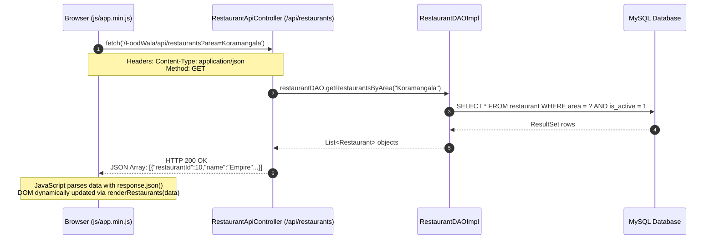

# 04. Frontend Architecture & Page Redirection Reference

## 1. Overview of the FoodWala Frontend Architecture

FoodWala features a lightweight, high-performance frontend architecture built on **HTML5, Modern CSS3, Vanilla ES6+ JavaScript, and Bootstrap 5.3**. 

Unlike bulky single-page framework applications (such as React or Angular) that require multi-megabyte bundle downloads before initial rendering, FoodWala loads in **under 200 milliseconds** by utilizing native browser technologies, semantic HTML5 document structures, and clean modular JavaScript modules (`js/app.min.js`, `js/adapters/mockAdapter.js`, `js/help-assistance.js`).

---

## 2. Master Page Redirection & Navigation Matrix

Every page navigation in FoodWala is documented below with its exact trigger, source file, logic conditions, and payload:

| # | Source Page | Destination Page | User Trigger / Event | Implementing File & Function | Conditions & Validation | Data Passed | Expected Result |
| :--- | :--- | :--- | :--- | :--- | :--- | :--- | :--- |
| 1 | `home.html` | `restaurants.html` | Click "Explore Restaurants" banner or search submit. | `js/app.min.js` &rarr; `handleSearch()` | Valid area or cuisine selected. | URL Param: `?area=Koramangala` | Filters restaurant list to selected zone. |
| 2 | `restaurants.html` | `menu.html` | Click on a restaurant card. | `js/app.min.js` &rarr; `openRestaurant(id)` | Restaurant must be active (`is_open=1`). | URL Param: `?id=10` | Loads restaurant info & categorized menu items. |
| 3 | `menu.html` | `cart.html` | Click floating "View Cart" button. | `js/app.min.js` &rarr; `viewCart()` | Cart must contain at least 1 item (`cart.items.length > 0`). | `localStorage` item array | Navigates to cart breakdown page. |
| 4 | `cart.html` | `checkout.html` | Click "Proceed to Checkout" button. | `js/app.min.js` &rarr; `proceedToCheckout()` | User must be logged in; subtotal must exceed minimum order (₹100). | `currentUser` token & cart payload | Directs authenticated user to delivery address selection. |
| 5 | `cart.html` | `login.html` | Click "Proceed to Checkout" while unauthenticated. | `js/app.min.js` &rarr; `checkAuth()` | `localStorage.getItem('currentUser') === null`. | URL Param: `?redirect=checkout.html` | Prompts customer to log in, then returns to checkout. |
| 6 | `login.html` | `checkout.html` or `home.html` | Successful customer login submission. | `login.html` &rarr; `handleLoginSubmit()` | Password verified via Argon2id/BCrypt. | Session token or User object | Redirects to intended destination or defaults to home. |
| 7 | `checkout.html` | Razorpay Modal &rarr; `order-confirmation.html` | Click "Pay & Place Order" (Razorpay chosen). | `js/app.min.js` &rarr; `initiatePayment()` | Delivery address selected; payment gateway signature verified. | `razorpay_order_id`, `razorpay_payment_id`, `signature` | Opens Razorpay modal; on success redirects to confirmation. |
| 8 | `checkout.html` | `order-confirmation.html` | Click "Place Order" (Cash on Delivery chosen). | `js/app.min.js` &rarr; `placeCodOrder()` | Address confirmed; OTP verified if mobile unconfirmed. | Order payload (COD) | Creates Order in DB with status `PLACED`, opens confirmation. |
| 9 | `order-confirmation.html` | `order-tracking.html` | Click "Track Live Order" button. | `order-confirmation.html` &rarr; `trackOrder(orderId)` | Order ID must be present in URL or state. | URL Param: `?orderId=FW70` | Loads Leaflet GPS map with valet location and delivery ETA. |
| 10 | `order-tracking.html` | WhatsApp Chat (`+1 555-196-0307`) | Click "Need Help? Chat on WhatsApp". | `js/help-assistance.js` &rarr; `openWhatsAppHelp()` | User clicks WhatsApp pill or drawer. | Pre-filled text: `Hi FoodWala, track my order #FW70` | Opens WhatsApp Web or WhatsApp Desktop app. |
| 11 | `orders.html` | `order-tracking.html` | Click "Track Order" on any past order card. | `orders.html` &rarr; `trackOrder(orderId)` | Order status not `DELIVERED` or `CANCELLED`. | URL Param: `?orderId=FW70` | Directs customer to real-time map tracking. |
| 12 | Any Page | `login.html` | Click "Logout" in navigation bar. | `js/app.min.js` &rarr; `logoutUser()` | User clicks logout. | Clears `localStorage` & terminates `HttpSession` | Logs user out, purges credentials, redirects to login. |
| 13 | `login.html` | `admin.html` | Administrator credentials authenticated. | `LoginController.java` or `handleLoginSubmit()` | User role equals `ADMIN`. | Admin JWT / Session | Bypasses customer storefront directly to Admin portal. |
| 14 | `login.html` | `restaurant-dashboard.html` | Restaurant owner credentials authenticated. | `LoginController.java` or `handleLoginSubmit()` | User role equals `RESTAURANT_OWNER`. | Restaurant ID mapping | Opens restaurant inventory & order management. |
| 15 | `login.html` | `delivery-dashboard.html` | Delivery valet credentials authenticated. | `LoginController.java` or `handleLoginSubmit()` | User role equals `DELIVERY_PARTNER`. | Valet ID & vehicle type | Opens delivery partner live delivery portal. |

---

## 3. Redirection Mechanisms: Technical Differences

Clients and senior developers frequently ask how redirection differs between client and server layers:

```
┌────────────────────────────────────────────────────────────────────────┐
│                        CLIENT-SIDE REDIRECTIONS                        │
├────────────────────────────────┬───────────────────────────────────────┤
│ Method                         │ Behavior                              │
├────────────────────────────────┼───────────────────────────────────────┤
│ <a href="restaurants.html">    │ Standard browser navigation. Adds a   │
│                                │ new entry to browser history stack.   │
├────────────────────────────────┼───────────────────────────────────────┤
│ window.location.href = url     │ Programmatic JavaScript navigation.   │
│                                │ Preserves back-button history.        │
├────────────────────────────────┼───────────────────────────────────────┤
│ window.location.replace(url)   │ Programmatic navigation that replaces │
│                                │ current URL in history (user cannot   │
│                                │ press 'Back' to re-submit payment).   │
└────────────────────────────────┴───────────────────────────────────────┘

┌────────────────────────────────────────────────────────────────────────┐
│                        SERVER-SIDE REDIRECTIONS                        │
├────────────────────────────────┬───────────────────────────────────────┤
│ Method                         │ Behavior                              │
├────────────────────────────────┼───────────────────────────────────────┤
│ response.sendRedirect(url)     │ HTTP 302 Found response sent to       │
│ (Used in LoginController)      │ browser. Browser initiates a brand new│
│                                │ GET request to the target URL.        │
├────────────────────────────────┼───────────────────────────────────────┤
│ requestDispatcher.forward(r,r) │ Internal server transfer. Browser URL │
│ (Used in Servlet / JSP views)  │ does NOT change; request/response     │
│                                │ attributes are preserved across views.│
└────────────────────────────────┴───────────────────────────────────────┘
```

---

## 4. How Frontend JavaScript Communicates with the Java Backend

FoodWala uses modern **Fetch API** calls to exchange JSON data with the backend:



### Real Code Implementation in FoodWala (`js/app.min.js`):
```javascript
// Function in FoodWala fetching restaurant list from backend
async function fetchRestaurants(cuisine = '', area = '') {
    try {
        const queryParams = new URLSearchParams();
        if (cuisine) queryParams.append('cuisine', cuisine);
        if (area) queryParams.append('area', area);

        // Call Java Servlet REST endpoint
        const response = await fetch(`/FoodWala/api/restaurants?${queryParams.toString()}`, {
            method: 'GET',
            headers: {
                'Accept': 'application/json',
                'Content-Type': 'application/json'
            }
        });

        if (!response.ok) {
            throw new Error(`HTTP error! status: ${response.status}`);
        }

        const data = await response.json();
        // Dynamically render UI cards
        renderRestaurantCards(data);
    } catch (error) {
        console.warn('Backend unavailable, activating fallback adapter:', error);
        // Seamless offline fallback using mockAdapter.js
        const fallbackData = FoodWalaMockAdapter.getRestaurants(cuisine, area);
        renderRestaurantCards(fallbackData);
    }
}
```

---

## 5. Client State Management

FoodWala manages state using clean, predictable storage layers:
1. **Cart State (`localStorage.getItem('cart')`)**:
   - Stores current restaurant ID, item IDs, quantities, item notes, and calculated subtotal.
   - Preserved across tab reloads and accidental browser closures.
2. **Authentication State (`localStorage.getItem('currentUser')`)**:
   - Stores authenticated user identity, role, email, and security token.
   - Cleared immediately upon clicking Logout.
3. **Session State (`HttpSession` on Tomcat)**:
   - Preserves secure server-side attributes (e.g. `user_id`, `role`, CSRF token) tied to the `JSESSIONID` HTTP-only cookie.
