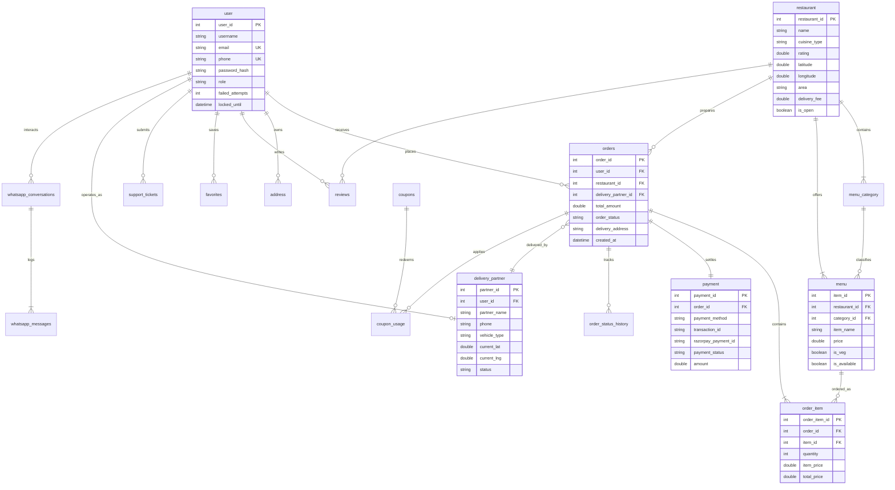

# 05. MySQL Database Architecture, JPA & Hibernate Guide

## 1. Relational Database Overview

FoodWala is powered by an enterprise relational schema deployed on **MySQL 8.0+ / 9.x** under the database name `fudwala`. 

The schema is normalized to **Third Normal Form (3NF)**, ensuring zero data redundancy while preserving high-speed query performance through strategic indexes, foreign key constraints, and transactional integrity (`InnoDB` storage engine).

---

## 2. Comprehensive 22-Table Schema Breakdown

| # | Table Name | Purpose | Primary Key | Key Foreign Keys & Constraints |
| :--- | :--- | :--- | :--- | :--- |
| 1 | `user` | Customer, Restaurant Owner, Delivery Valet, and Admin accounts. | `user_id` (INT AUTO_INCREMENT) | `UNIQUE(email)`, `UNIQUE(phone)` |
| 2 | `restaurant` | 105 food establishments, geolocations, cuisine types, ratings, and operating hours. | `restaurant_id` (INT AUTO_INCREMENT) | `admin_user_id` &rarr; `user(user_id)` |
| 3 | `menu_category` | 416 categorized sections within restaurants (e.g. Starters, Biryanis, Desserts). | `category_id` (INT AUTO_INCREMENT) | `restaurant_id` &rarr; `restaurant(restaurant_id)` |
| 4 | `menu` | 756 individual food dishes, pricing, description, veg/non-veg flag, and stock. | `item_id` (INT AUTO_INCREMENT) | `restaurant_id` &rarr; `restaurant`, `category_id` &rarr; `menu_category` |
| 5 | `orders` | Core transactional header: total price, status, delivery coordinates, valet assignment. | `order_id` (INT AUTO_INCREMENT) | `user_id` &rarr; `user`, `restaurant_id` &rarr; `restaurant`, `delivery_partner_id` &rarr; `delivery_partner` |
| 6 | `order_item` | Line items capturing item name, quantity, unit price, and subtotal at time of order. | `order_item_id` (INT AUTO_INCREMENT) | `order_id` &rarr; `orders(order_id)`, `item_id` &rarr; `menu(item_id)` |
| 7 | `payment` | Payment records: transaction ID, method (RAZORPAY, COD), Razorpay IDs, and status. | `payment_id` (INT AUTO_INCREMENT) | `order_id` &rarr; `orders(order_id)` |
| 8 | `address` | Saved customer addresses (Home, Work, Other) with GPS coordinates and notes. | `address_id` (INT AUTO_INCREMENT) | `user_id` &rarr; `user(user_id)` |
| 9 | `delivery_partner` | Delivery fleet valets, vehicle details, current latitude/longitude, and availability. | `partner_id` (INT AUTO_INCREMENT) | `user_id` &rarr; `user(user_id)` |
| 10 | `coupons` | Promotional promo codes, minimum spend, discount amount, and expiry dates. | `coupon_id` (INT AUTO_INCREMENT) | `UNIQUE(code)` |
| 11 | `coupon_usage` | Tracks which user redeemed which coupon to enforce 1-time redemption limits. | `usage_id` (INT AUTO_INCREMENT) | `coupon_id` &rarr; `coupons`, `user_id` &rarr; `user`, `order_id` &rarr; `orders` |
| 12 | `reviews` | Customer ratings (1 to 5 stars) and feedback for restaurants and food dishes. | `review_id` (INT AUTO_INCREMENT) | `user_id` &rarr; `user`, `restaurant_id` &rarr; `restaurant` |
| 13 | `favorites` | Customer bookmarks for quick ordering of preferred restaurants. | `favorite_id` (INT AUTO_INCREMENT) | `user_id` &rarr; `user`, `restaurant_id` &rarr; `restaurant` |
| 14 | `order_status_history`| Audit log of timestamped status transitions (`PLACED` &rarr; `PREPARING` &rarr; `OUT_FOR_DELIVERY` &rarr; `DELIVERED`). | `history_id` (INT AUTO_INCREMENT) | `order_id` &rarr; `orders(order_id)` |
| 15 | `support_tickets` | Customer service inquiries, issues, and resolution statuses. | `ticket_id` (INT AUTO_INCREMENT) | `user_id` &rarr; `user`, `order_id` &rarr; `orders` |
| 16 | `activity_log` | Platform security and system events audit trail. | `log_id` (INT AUTO_INCREMENT) | `user_id` &rarr; `user(user_id)` |
| 17 | `login_history` | Timestamped IP, user-agent, and status of every login attempt. | `login_id` (INT AUTO_INCREMENT) | `user_id` &rarr; `user(user_id)` |
| 18 | `cart` | Persistent server-side cart header. | `cart_id` (INT AUTO_INCREMENT) | `user_id` &rarr; `user`, `restaurant_id` &rarr; `restaurant` |
| 19 | `cart_item` | Persistent server-side cart items. | `cart_item_id` (INT AUTO_INCREMENT) | `cart_id` &rarr; `cart`, `item_id` &rarr; `menu` |
| 20 | `notifications` | In-app alerts and notifications dispatched to customers. | `notification_id` (INT AUTO_INCREMENT) | `user_id` &rarr; `user(user_id)` |
| 21 | `whatsapp_conversations`| Thread context for incoming WhatsApp customer messages. | `conversation_id` (INT AUTO_INCREMENT) | `user_id` &rarr; `user(user_id)` |
| 22 | `whatsapp_messages` | Full inbound and outbound WhatsApp message telemetry with delivery status. | `message_id` (INT AUTO_INCREMENT) | `conversation_id` &rarr; `whatsapp_conversations` |

---

## 3. Entity-Relationship (ER) Diagram



---

## 4. Practical SQL Queries from FoodWala

### 4.1 Multi-Table `INNER JOIN` (Live Order Tracking Telemetry)
In `OrderDAOImpl.java`, when a customer views `order-tracking.html`, the backend executes a 4-table relational join:
```sql
SELECT 
    o.order_id,
    o.order_status,
    o.total_amount,
    o.created_at,
    r.name AS restaurant_name,
    r.latitude AS restaurant_lat,
    r.longitude AS restaurant_lng,
    dp.partner_name AS valet_name,
    dp.phone AS valet_phone,
    dp.current_lat AS valet_lat,
    dp.current_lng AS valet_lng,
    p.payment_status,
    p.payment_method
FROM orders o
INNER JOIN restaurant r ON o.restaurant_id = r.restaurant_id
LEFT JOIN delivery_partner dp ON o.delivery_partner_id = dp.partner_id
LEFT JOIN payment p ON o.order_id = p.order_id
WHERE o.order_id = ? AND o.user_id = ?;
```

### 4.2 Parameterized `INSERT` with Generated Keys (Order Item Persistence)
In `OrderItemDAOImpl.java`:
```sql
INSERT INTO order_item (order_id, item_id, item_name, quantity, item_price, total_price)
VALUES (?, ?, ?, ?, ?, ?);
```

### 4.3 Atomic State Transition `UPDATE` (Valet Status Progression)
In `OrderStatusHistoryDAOImpl.java`:
```sql
UPDATE orders 
SET order_status = 'OUT_FOR_DELIVERY', updated_at = NOW() 
WHERE order_id = ?;

INSERT INTO order_status_history (order_id, status, notes, updated_at) 
VALUES (?, 'OUT_FOR_DELIVERY', 'Valet has picked up package and is en route', NOW());
```

---

## 5. JPA & Hibernate Deep Dive

### 5.1 What is JPA (Jakarta Persistence API)?
JPA is the **specification** (a collection of interfaces and standard annotations) that defines how Java objects map to relational database tables.

### 5.2 What is Hibernate?
Hibernate is the **implementation** (ORM engine) that implements the JPA specification. It translates Java object operations (`session.persist()`, `session.find()`) into raw SQL dialects (`MySQL8Dialect`).

### 5.3 Essential JPA Annotations Mapped to FoodWala

```java
package com.foodwala.entity;

import jakarta.persistence.*;
import java.util.List;

@Entity                                          // 1. Marks class as JPA Entity
@Table(name = "orders")                          // 2. Maps to table 'orders'
public class OrderEntity {

    @Id                                          // 3. Primary Key
    @GeneratedValue(strategy = GenerationType.IDENTITY) // 4. AUTO_INCREMENT
    @Column(name = "order_id")
    private Integer orderId;

    @Column(name = "total_amount", nullable = false)
    private Double totalAmount;

    @Enumerated(EnumType.STRING)
    @Column(name = "order_status")
    private OrderStatus status;                  // PLACED, PREPARING, DELIVERED

    @ManyToOne(fetch = FetchType.LAZY)           // 5. Many Orders belong to One User
    @JoinColumn(name = "user_id", nullable = false) // Foreign Key Column
    private UserEntity user;

    @ManyToOne(fetch = FetchType.LAZY)
    @JoinColumn(name = "restaurant_id", nullable = false)
    private RestaurantEntity restaurant;

    @OneToMany(mappedBy = "order", cascade = CascadeType.ALL, orphanRemoval = true) // 6. One Order has Many Items
    private List<OrderItemEntity> orderItems;

    @OneToOne(mappedBy = "order", cascade = CascadeType.ALL) // 7. One Order has One Payment
    private PaymentEntity payment;
}
```

---

## 6. Critical Hibernate Architecture Questions

### 6.1 What is Lazy Loading vs Eager Loading?
- **`FetchType.LAZY` (Recommended)**: The associated entity is **not** loaded from MySQL until you explicitly call `order.getOrderItems()`. Prevents loading massive trees of data into memory when only the order status is needed.
- **`FetchType.EAGER`**: The associated entity is loaded immediately using an SQL `JOIN` on every query. If used carelessly, it leads to the infamous **N+1 Query Problem**.

### 6.2 What is CascadeType?
`CascadeType` controls whether database operations on a parent entity automatically propagate to child entities:
- `CascadeType.ALL`: Saving or deleting an `Order` automatically saves or deletes its corresponding `OrderItem` records.

### 6.3 What is the Difference between `JpaRepository` and `CrudRepository`?
- `CrudRepository`: Provides standard CRUD methods (`save`, `findById`, `delete`).
- `JpaRepository`: Extends `CrudRepository` + `PagingAndSortingRepository`. Adds JPA-specific capabilities like batch deletions (`deleteInBatch()`), flush operations (`flush()`), and returns `List` rather than `Iterable`.
