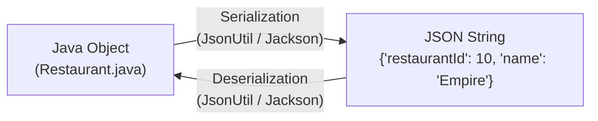

# 06. Backend Architecture & REST API Documentation

## 1. REST API Architecture in FoodWala

FoodWala provides a unified RESTful API layer that serves both the browser frontend and external client integrations (e.g., WhatsApp Webhooks). 

The APIs adhere to **REST (Representational State Transfer)** principles:
- **Statelessness**: Every request contains all information necessary for the server to fulfill it.
- **Uniform Resource Identifiers (URIs)**: Nouns identify resources (e.g. `/api/restaurants`, `/api/orders`), while standard HTTP verbs define the action.
- **JSON Standard**: All payloads are formatted in `application/json;charset=UTF-8`.

---

## 2. Complete REST API Reference Table

### 2.1 Java Enterprise REST Endpoints (Apache Tomcat 11 - Port 8080)

| Endpoint | Method | Controller Class | Request Params / Body | Response Payload (JSON) | Status Codes | Auth Required | Database Tables |
| :--- | :--- | :--- | :--- | :--- | :--- | :--- | :--- |
| `/FoodWala/api/restaurants` | `GET` | `RestaurantApiController` | `?cuisine=Biryani&area=Koramangala` | `[{"restaurantId":10,"name":"Empire"...}]` | `200`, `500` | Public | `restaurant` |
| `/FoodWala/api/restaurants/cuisines` | `GET` | `RestaurantApiController` | None | `{"success":true,"cuisines":["North Indian","Biryani"...]}` | `200` | Public | `restaurant` |
| `/FoodWala/api/restaurants/areas` | `GET` | `RestaurantApiController` | None | `{"success":true,"areas":["Koramangala","Indiranagar"...]}` | `200` | Public | `restaurant` |
| `/FoodWala/api/search/suggestions` | `GET` | `RestaurantApiController` | `?q=paneer` | `{"success":true,"suggestions":[{"type":"dish","name":"Paneer Butter Masala"}]}` | `200` | Public | `restaurant`, `menu` |
| `/FoodWala/api/menu` | `GET` | `MenuApiController` | `?restaurantId=10` | `{"restaurant":{...},"categories":[{"categoryId":1,"items":[...]}]}` | `200`, `404` | Public | `menu`, `menu_category` |
| `/FoodWala/api/location/coordinates` | `POST` | `LocationController` | `{"latitude":12.97,"longitude":77.59}` | `{"success":true,"matchedArea":"Bengaluru Central"}` | `200`, `400` | Public | Memory / `LocationUtil` |
| `/FoodWala/api/send-otp` | `POST` | `SendOTPServlet` | `phone=916301382491&purpose=LOGIN` | `{"success":true,"message":"OTP dispatched"}` | `200`, `400`, `500` | Public | `user` |
| `/FoodWala/api/verify-otp` | `POST` | `VerifyOTPServlet` | `phone=916301382491&otp=123456` | `{"success":true,"verified":true}` | `200`, `401` | Public | `user` |
| `/FoodWala/api/reset-password` | `POST` | `PasswordResetServlet` | `token=xyz&newPassword=Password@123` | `{"success":true,"message":"Password updated"}` | `200`, `400` | Public (Token) | `user` |

---

### 2.2 Companion Microservice REST Endpoints (Node.js Express - Port 5000)

| Endpoint | Method | Controller / File | Request Params / Body | Response Payload (JSON) | Status Codes | Auth Required | Database Tables |
| :--- | :--- | :--- | :--- | :--- | :--- | :--- | :--- |
| `/api/auth/register` | `POST` | `server/controllers/authController.js` | `{"username":"v","email":"v@f.com","password":"P@1","phone":"91..."}` | `{"success":true,"user":{"userId":1,"email":"v@f.com"}}` | `201`, `400`, `409` | Public | `user` |
| `/api/auth/login` | `POST` | `server/controllers/authController.js` | `{"identifier":"v@f.com","password":"P@1"}` | `{"success":true,"token":"eyJ...","user":{...}}` | `200`, `401`, `423` (Locked) | Public | `user`, `login_history` |
| `/api/orders` | `POST` | `server/controllers/orderController.js` | `{"restaurantId":10,"items":[...],"deliveryAddress":"..."}` | `{"success":true,"orderId":"FW70","totalAmount":630}` | `201`, `400`, `401` | Customer JWT / Session | `orders`, `order_item` |
| `/api/whatsapp/webhook` | `GET` | `server/controllers/whatsappController.js` | `?hub.mode=subscribe&hub.challenge=...&hub.verify_token=...` | Plain challenge token echo | `200`, `403` | Meta Verify Token | None |
| `/api/whatsapp/webhook` | `POST` | `server/controllers/whatsappController.js` | Meta Cloud API Webhook Event JSON | `{"status":"EVENT_RECEIVED"}` | `200` | Meta Webhook Signature | `whatsapp_conversations`, `whatsapp_messages`, `orders` |
| `/api/whatsapp/health` | `GET` | `server/controllers/whatsappController.js` | None | `{"status":"healthy","uptime":...}` | `200` | Public | None |

---

## 3. Understanding HTTP Verbs & Idempotency

Clients frequently ask about the technical semantics of HTTP methods:

```
┌─────────┬──────────────┬─────────────┬────────────────────────────────────────────┐
│ Method  │ Idempotent?  │ Safe Cache? │ FoodWala Usage                             │
├─────────┼──────────────┼─────────────┼────────────────────────────────────────────┤
│ GET     │ YES          │ YES         │ Retrieve restaurants, menus, order status. │
│ POST    │ NO           │ NO          │ Create new orders, initiate payments, auth.│
│ PUT     │ YES          │ NO          │ Replace full user profile / address book.  │
│ PATCH   │ NO           │ NO          │ Update order status (e.g. PREPARING).      │
│ DELETE  │ YES          │ NO          │ Remove cart item, delete saved address.    │
└─────────┴──────────────┴─────────────┴────────────────────────────────────────────┘
```

> **What does "Idempotent" mean?**  
> An HTTP method is idempotent if making the identical request multiple times produces the exact same outcome on the server. For example, `GET /api/restaurants` can be called 100 times without changing database state. However, calling `POST /api/orders` 100 times could place 100 duplicate orders unless protected with an idempotency key!

---

## 4. JSON Serialization & Deserialization

In Java enterprise architectures, moving between Java Objects and JSON strings requires serialization engines:



### In FoodWala's Actual Java Code (`JsonUtil.java`):
```java
package com.tap.util;

import com.tap.model.Restaurant;
import java.util.List;

public class JsonUtil {
    public static String escapeJson(String s) {
        if (s == null) return "";
        return s.replace("\\", "\\\\")
                .replace("\"", "\\\"")
                .replace("\n", "\\n")
                .replace("\r", "\\r");
    }

    public static String restaurantToJson(Restaurant r) {
        return String.format(
            "{\"restaurantId\":%d,\"name\":\"%s\",\"cuisineType\":\"%s\",\"rating\":%.1f,\"area\":\"%s\"}",
            r.getRestaurantId(),
            escapeJson(r.getName()),
            escapeJson(r.getCuisineType()),
            r.getRating(),
            escapeJson(r.getArea())
        );
    }
}
```

---

## 5. The Data Transfer Object (DTO) Pattern

### 5.1 Why DTOs are Essential in Enterprise Architecture
A **DTO (Data Transfer Object)** is an object that carries data between processes. Why not just return the database Entity directly?
1. **Security (Prevent Credential Leakage)**: If you return the `User` database entity directly over a REST API, you risk accidentally serializing `password_hash`, `failed_attempts`, or `reset_token` to the client! A `UserResponseDTO` strips these sensitive fields.
2. **Decoupling**: Prevents client contracts from breaking when database column names change.
3. **Payload Optimization**: Flattens nested circular JPA references (e.g. Order &rarr; User &rarr; Order) into a lean, fast JSON response.

### 5.2 Example DTO in FoodWala
```java
// Safe Customer DTO exposed to frontend
public class CustomerProfileDTO {
    private int userId;
    private String username;
    private String email;
    private String phone;
    // Notice: NO passwordHash, NO resetToken!
}
```
