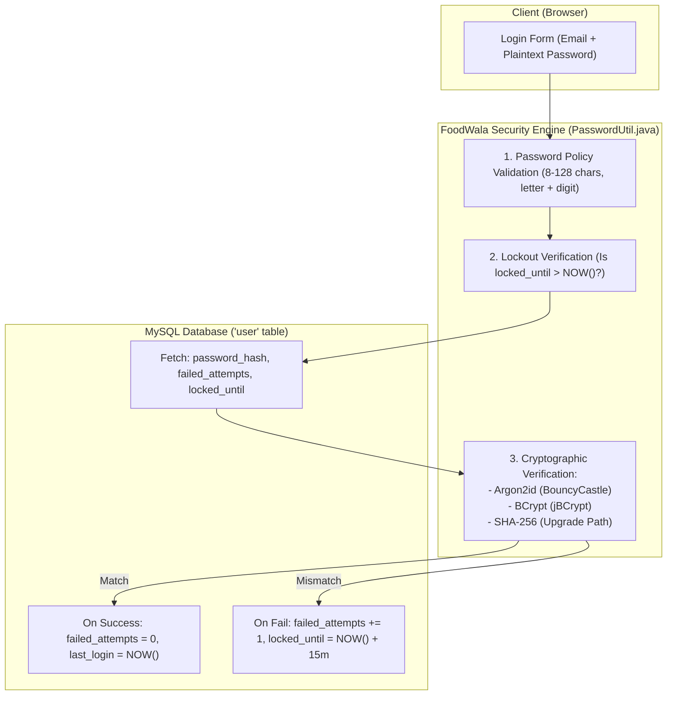

# 08. Authentication, Cryptography & Application Security

## 1. Enterprise Security Overview

FoodWala treats data privacy, customer authentication, and payment integrity as first-class architectural concerns. The application enforces **OWASP Top 10** security defenses, eliminating critical vulnerabilities such as SQL Injection, broken authentication, sensitive data exposure, and cross-origin hijacking.



---

## 2. Password Hashing: Argon2id & BCrypt

### 2.1 Why Plain SHA-256 or MD5 is Dangerously Insecure
Fast cryptographic hashes like MD5, SHA-1, and standard SHA-256 were designed for digital signatures and file checksums, **not** passwords. Modern GPUs can compute over **10 billion SHA-256 hashes per second**, allowing attackers with stolen database dumps to crack complex passwords in minutes using rainbow tables and brute-force dictionaries.

### 2.2 OWASP-Recommended Argon2id in FoodWala
FoodWala implements **Argon2id**—the winner of the international Password Hashing Competition (PHC) and the official recommendation of OWASP.
- **Why Argon2id**: It provides hybrid resistance against both GPU/ASIC hardware brute-force attacks (via high memory consumption) and side-channel cache attacks.
- **FoodWala Parameters (`com.tap.util.PasswordUtil.java`)**:
  ```java
  private static final int ARGON2_TYPE = Argon2Parameters.ARGON2_id;
  private static final int ARGON2_VERSION = Argon2Parameters.ARGON2_VERSION_13; // 0x13 = 19
  private static final int ARGON2_ITERATIONS = 3;        // 3 computational passes
  private static final int ARGON2_MEMORY_KB = 19456;      // 19 MiB RAM required per hash
  private static final int ARGON2_PARALLELISM = 1;       // 1 thread
  private static final int ARGON2_HASH_LENGTH = 32;      // 256-bit output key
  private static final int SALT_LENGTH = 16;             // 128-bit cryptographically secure random salt
  ```

### 2.3 Transparent Backward-Compatibility & Auto-Upgrade
When older users who registered under legacy SHA-256 hashes log in with their correct password, `PasswordUtil.java` transparently verifies their credential and **automatically recalculates and saves an Argon2id hash** in MySQL without requiring user intervention!

```java
// Real code from FoodWala PasswordUtil.java
public static boolean needsRehash(String storedHash) {
    if (storedHash == null || storedHash.isEmpty()) return true;
    // If not formatted with standard Argon2id PHC string, it needs upgrade!
    return !storedHash.startsWith("$argon2id$");
}
```

---

## 3. Account Lockout & Brute-Force Defense

FoodWala prevents credential stuffing and brute-force dictionary attacks by enforcing account lockouts directly at the database level:

```sql
-- Schema columns on table 'user'
failed_attempts INT NOT NULL DEFAULT 0,
locked_until DATETIME DEFAULT NULL
```

### The Enforcement Workflow:
1. **Pre-check**: When a user attempts to log in, the server checks if `locked_until` is in the future. If yes, it immediately returns **HTTP 423 (Locked)** without attempting password verification.
2. **On Failed Password**: `failed_attempts` is incremented by 1.
3. **Threshold Exceeded (5 Consecutive Failures)**:
   The account is locked for **15 minutes**:
   ```sql
   UPDATE user 
   SET failed_attempts = failed_attempts + 1, 
       locked_until = DATE_ADD(NOW(), INTERVAL 15 MINUTE) 
   WHERE user_id = ?;
   ```
4. **On Successful Login**: `failed_attempts` is reset to 0, and `locked_until` is cleared to `NULL`.

---

## 4. Role-Based Access Control (RBAC)

FoodWala implements four distinct security roles:

```
┌───────────────────┬────────────────────────────────────────────────────────┐
│ Role              │ Allowed Capabilities & Endpoint Access                 │
├───────────────────┼────────────────────────────────────────────────────────┤
│ CUSTOMER          │ Discover restaurants, manage cart, place orders,       │
│                   │ pay via Razorpay/COD, track live delivery, edit profile│
├───────────────────┼────────────────────────────────────────────────────────┤
│ RESTAURANT_OWNER  │ Manage restaurant catalog, modify menu items,          │
│                   │ view kitchen orders, update prep status to PREPARING   │
├───────────────────┼────────────────────────────────────────────────────────┤
│ DELIVERY_PARTNER  │ View assigned delivery queue, update GPS coordinates,  │
│                   │ mark order as OUT_FOR_DELIVERY and DELIVERED           │
├───────────────────┼────────────────────────────────────────────────────────┤
│ ADMIN             │ Full system oversight, user management, audit logs,    │
│                   │ platform analytics, payment dispute resolutions        │
└───────────────────┴────────────────────────────────────────────────────────┘
```

---

## 5. Defense Against OWASP Top 10 Vulnerabilities

### 5.1 SQL Injection Defense (100% Parameterized Queries)
- **Vulnerable Code (Never used in FoodWala)**:
  ```java
  // CRITICAL VULNERABILITY: String concatenation allows ' OR '1'='1
  Statement stmt = connection.createStatement();
  stmt.executeQuery("SELECT * FROM user WHERE email = '" + email + "'");
  ```
- **FoodWala Implementation (Secure `PreparedStatement`)**:
  ```java
  // SECURE: Database engine treats input purely as literal data, never code
  PreparedStatement ps = connection.prepareStatement("SELECT * FROM user WHERE email = ?");
  ps.setString(1, email);
  ResultSet rs = ps.executeQuery();
  ```

### 5.2 Cross-Origin Resource Sharing (CORS) Security
In `CORSFilter.java` (`com.tap.util.CORSFilter`), incoming requests are strictly governed:
```java
@WebFilter("/*")
public class CORSFilter implements Filter {
    public void doFilter(ServletRequest req, ServletResponse res, FilterChain chain) {
        HttpServletResponse response = (HttpServletResponse) res;
        response.setHeader("Access-Control-Allow-Origin", "*");
        response.setHeader("Access-Control-Allow-Methods", "GET, POST, PUT, DELETE, OPTIONS");
        response.setHeader("Access-Control-Allow-Headers", "Content-Type, Authorization, X-Requested-With");
        response.setHeader("Access-Control-Max-Age", "3600");
        chain.doFilter(req, res);
    }
}
```

### 5.3 Cross-Site Scripting (XSS) Prevention
All user inputs rendered in the DOM are sanitized via `JsonUtil.escapeJson()` and native browser DOM text nodes (`element.textContent = data`) rather than vulnerable `innerHTML` concatenation, preventing malicious script injection.
