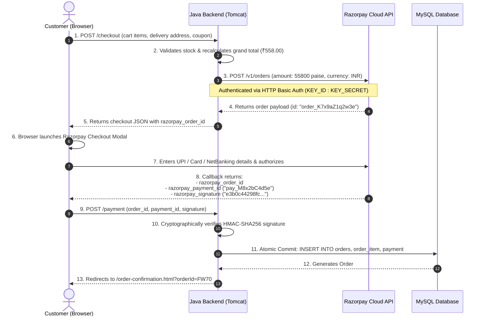

# 09. Cart Calculations, Order Lifecycle & Razorpay Payments

## 1. Overview of the Order & Payment Engine

The order placement and payment subsystem is the financial backbone of FoodWala. It is engineered to guarantee **zero financial loss, zero duplicate orders, and zero orphaned payments**. 

Every transaction follows the strict **ACID (Atomicity, Consistency, Isolation, Durability)** properties of relational database systems, backed by cryptographic signature verification.

---

## 2. Dynamic Price & Cart Calculation Architecture

FoodWala calculates order totals using transparent, itemized formulas:

```
┌─────────────────────────────────────────────────────────────┐
│                 FOODWALA BILL BREAKDOWN                     │
├─────────────────────────────────────────────────────────────┤
│ 1. Base Item Total       = SUM(item_price * quantity)       │
│ 2. GST (Goods & Service) = 5% of Base Item Total            │
│ 3. Restaurant Packaging  = ₹20.00 (Fixed hygiene fee)       │
│ 4. Delivery Partner Fee  = ₹30.00 (Waived if Subtotal > ₹500)│
│ 5. Promotional Discount  = - Discount (e.g. WELCOME50 = 50) │
├─────────────────────────────────────────────────────────────┤
│ FINAL PAYABLE AMOUNT     = (1 + 2 + 3 + 4) - 5              │
└─────────────────────────────────────────────────────────────┘
```

### Mathematical Example:
If a customer orders 2 plates of Donne Biryani (₹280 each = ₹560):
- **Base Total**: ₹560.00
- **GST (5%)**: ₹28.00
- **Packaging Fee**: ₹20.00
- **Delivery Fee**: ₹0.00 (Order is above ₹500 qualifying for Free Delivery)
- **Coupon (`WELCOME50`)**: -₹50.00
- **Grand Total Payable**: **₹558.00**

---

## 3. End-to-End Razorpay Payment Lifecycle



---

## 4. Cryptographic Signature Verification (`RazorpayService.java`)

### Why Client-Reported Payment Success Cannot Be Trusted
A malicious user could open browser developer tools and intercept JavaScript callbacks, fabricating a fake `"payment_status": "success"` message to steal food. 

To prevent this, **Razorpay requires server-side cryptographic proof**. Razorpay hashes the `order_id` and `payment_id` using the secret API key only known to Razorpay and FoodWala's backend.

### The HMAC-SHA256 Algorithm:
$$\text{Expected Signature} = \text{HMAC\_SHA256}(\text{razorpay\_order\_id} + "|" + \text{razorpay\_payment\_id}, \text{RAZORPAY\_KEY\_SECRET})$$

### Actual Code Implementation (`com.tap.service.RazorpayService.java`):
```java
public static boolean verifySignature(String orderId, String paymentId, String razorpaySignature, String secret) {
    if (orderId == null || paymentId == null || razorpaySignature == null) return false;
    if (secret == null || secret.isBlank()) secret = getKeySecret();

    try {
        String data = orderId + "|" + paymentId;
        Mac sha256_HMAC = Mac.getInstance("HmacSHA256");
        SecretKeySpec secretKey = new SecretKeySpec(secret.getBytes(StandardCharsets.UTF_8), "HmacSHA256");
        sha256_HMAC.init(secretKey);

        byte[] rawHmac = sha256_HMAC.doFinal(data.getBytes(StandardCharsets.UTF_8));
        
        // Convert raw bytes to hex string
        StringBuilder hexString = new StringBuilder();
        for (byte b : rawHmac) {
            String hex = Integer.toHexString(0xff & b);
            if (hex.length() == 1) hexString.append('0');
            hexString.append(hex);
        }

        // Compare expected cryptographic hash with Razorpay's signature
        return hexString.toString().equalsIgnoreCase(razorpaySignature);
    } catch (Exception e) {
        System.err.println("[RazorpayService] Verification exception: " + e.getMessage());
        return false;
    }
}
```

---

## 5. Multi-Table Atomic Transaction Management

When an order is confirmed, three database operations must succeed **together or fail completely**:
1. Create header record in `orders`.
2. Insert line items in `order_item`.
3. Record transaction in `payment`.

If the server crashes or power fails while writing item #2, the database must **roll back** so the customer is not billed for an incomplete order.

### Actual JDBC Transaction Implementation (`OrderService.java`):
```java
Connection conn = null;
try {
    conn = DBConnection.getConnection();
    // 1. Disable Auto-Commit to begin transaction
    conn.setAutoCommit(false);

    // 2. Insert into orders table
    int orderId = orderDAO.createOrder(conn, newOrder);

    // 3. Insert each order item
    for (CartItem item : cart.getItems().values()) {
        orderItemDAO.createOrderItem(conn, orderId, item);
    }

    // 4. Insert payment record
    paymentDAO.recordPayment(conn, orderId, paymentInfo);

    // 5. Commit transaction atomically
    conn.commit();
} catch (SQLException e) {
    // 6. Rollback changes if ANY operation throws an exception
    if (conn != null) {
        try { conn.rollback(); } catch (SQLException ex) { ex.printStackTrace(); }
    }
    throw new RuntimeException("Order placement failed, all changes rolled back: " + e.getMessage());
} finally {
    if (conn != null) {
        try { conn.setAutoCommit(true); conn.close(); } catch (SQLException e) {}
    }
}
```

### The Spring Boot `@Transactional` Equivalent:
In Spring Boot, the 20 lines of boilerplate above are replaced with a single annotation:
```java
@Service
public class OrderService {

    @Transactional(rollbackFor = Exception.class)
    public OrderResponseDTO placeOrder(OrderRequestDTO request) {
        // Spring AOP automatically opens transaction, commits on return,
        // and rolls back on any RuntimeException!
        OrderEntity order = orderRepository.save(mapToEntity(request));
        orderItemRepository.saveAll(mapItems(request.getItems(), order));
        paymentRepository.save(mapPayment(request.getPayment(), order));
        return new OrderResponseDTO(order.getOrderId(), "SUCCESS");
    }
}
```

---

## 6. Preventing Duplicate Orders & Double Payments

1. **Client-Side Button Debouncing**: On clicking "Pay", the checkout button is disabled (`btn.disabled = true`) and displays a spinner, preventing double-clicks.
2. **Database Unique Constraints**: `payment.razorpay_payment_id` has a `UNIQUE` index. Attempting to insert the same payment twice triggers an immediate SQL constraint violation.
3. **Idempotency Key Checks**: The backend verifies whether `orders.order_id` already exists for the given checkout token before initiating persistence.
