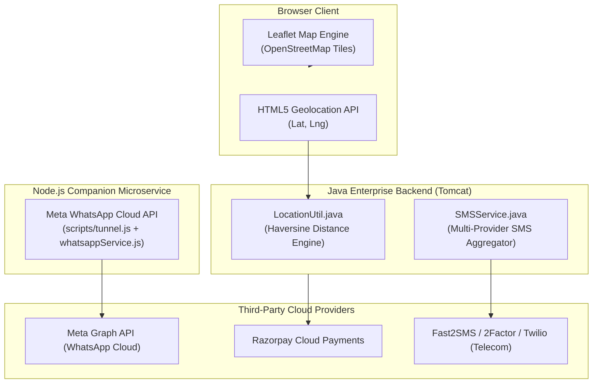
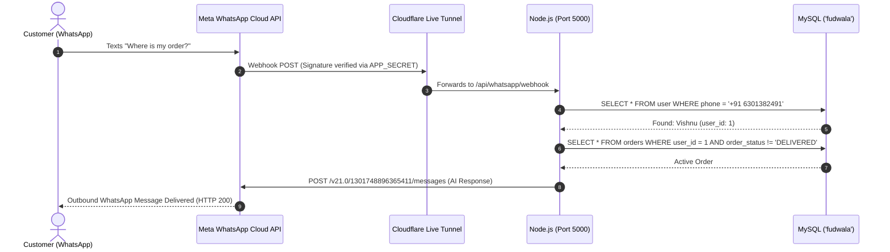

# 10. Geolocation, Maps, WhatsApp AI & Third-Party Integrations

## 1. Overview of External Integrations

FoodWala connects modern web browsers with real-world infrastructure: physical GPS sensors, digital mapping engines, international SMS telecom aggregators, and Meta's global WhatsApp messaging network.



---

## 2. GPS Geolocation & The Haversine Formula

### 2.1 The Problem: Calculating Distance on a Spherical Earth
Traditional Euclidean distance calculations ($\sqrt{\Delta x^2 + \Delta y^2}$) are completely inaccurate over geographic distances because the Earth is an oblate spheroid, not a flat plane. 

### 2.2 The Solution: The Haversine Equation
FoodWala calculates the great-circle distance between customer coordinates and restaurant coordinates using the **Haversine Formula**:

$$a = \sin^2\left(\frac{\Delta \phi}{2}\right) + \cos(\phi_1)\cos(\phi_2)\sin^2\left(\frac{\Delta \lambda}{2}\right)$$
$$c = 2 \cdot \arctan2\left(\sqrt{a}, \sqrt{1-a}\right)$$
$$d = R \cdot c$$

Where:
- $\phi_1, \phi_2$ = latitudes in radians
- $\Delta \phi = \phi_2 - \phi_1$
- $\Delta \lambda = \lambda_2 - \lambda_1$ (longitude difference in radians)
- $R$ = Earth's mean radius ($6,371\text{ km}$)
- $d$ = Resulting distance in kilometers

### 2.3 Actual Code Implementation in FoodWala (`LocationUtil.java`):
```java
package com.tap.util;

public final class LocationUtil {
    private static final double EARTH_RADIUS_KM = 6371.0;

    public static double calculateDistanceKm(double lat1, double lon1, double lat2, double lon2) {
        double dLat = Math.toRadians(lat2 - lat1);
        double dLon = Math.toRadians(lon2 - lon1);

        double a = Math.sin(dLat / 2) * Math.sin(dLat / 2) +
                   Math.cos(Math.toRadians(lat1)) * Math.cos(Math.toRadians(lat2)) *
                   Math.sin(dLon / 2) * Math.sin(dLon / 2);

        double c = 2 * Math.atan2(Math.sqrt(a), Math.sqrt(1 - a));
        return EARTH_RADIUS_KM * c;
    }

    public static int estimateDeliveryMinutes(double distanceKm) {
        // Base prep time (15 mins) + 3 mins per kilometer
        int minutes = 15 + (int) Math.round(distanceKm * 3.0);
        return Math.max(20, Math.min(minutes, 60)); // Clamp between 20 and 60 mins
    }
}
```

---

## 3. Interactive Leaflet Map Integration

FoodWala renders live valet tracking using **Leaflet.js (v1.9.4)**:
- **Zero API Billing**: Uses open-source **OpenStreetMap** tile layers (`https://{s}.tile.openstreetmap.org/{z}/{x}/{y}.png`), avoiding Google Maps API billing surprises.
- **Custom Vector Markers**:
  - 🏠 Customer Home: Blue pin with pulsing radar ring.
  - 🍳 Restaurant Kitchen: Orange chef hat icon.
  - 🛵 Delivery Valet: Animated bike marker updating in real-time.
- **Route Polyline**: Draws an illuminated trajectory linking restaurant &rarr; valet &rarr; customer destination.

---

## 4. Meta WhatsApp Cloud API AI Integration

### 4.1 Purpose & User Experience
Customers can text the official FoodWala WhatsApp hotline (`+1 555-196-0307`):
- *"Where is my order?"* &rarr; AI identifies the customer's phone number, queries active orders in MySQL, and replies with Order #FW70 status, valet name (Suresh Kumar), and ETA.
- *"How do I cancel?"* &rarr; AI explains the 60-second instant refund cancellation policy.

### 4.2 Architectural Breakdown:


### 4.3 Automated Cloudflare Tunneling (`scripts/tunnel.js`)
Because developers frequently work on dynamic IP addresses or behind university/office firewalls:
1. `scripts/tunnel.js` automatically launches `cloudflared.exe`.
2. It captures the dynamic public URL (e.g. `https://filme-wto-mileage-surrounded.trycloudflare.com`).
3. It makes an automated Graph API call to Meta's subscription endpoint (`POST /v21.0/4702946809933364/subscriptions`) and registers the new webhook URL with zero human effort!

---

## 5. Multi-Provider SMS Gateway Architecture (`SMSService.java`)

FoodWala provides a unified, pluggable SMS engine supporting 5 distinct provider drivers:

```
┌────────────────────────────────────────────────────────────────────────┐
│                        SMSService (Java EE)                            │
├───────────────────┬────────────────────────────────────────────────────┤
│ Driver            │ Implementation & Usage                             │
├───────────────────┼────────────────────────────────────────────────────┤
│ Fast2SMS (India)  │ Quick Indian carrier delivery (DLT-compliant).     │
│ 2Factor (India)   │ High-reliability OTP route with auto-generated PIN.│
│ Twilio (Global)   │ International SMS via Twilio REST API.             │
│ MSG91             │ Indian enterprise transactional SMS route.         │
│ Console (Dev)     │ Logs OTP directly to terminal (Zero cost for dev). │
└───────────────────┴────────────────────────────────────────────────────┘
```

### Configuration via `sms.properties`:
```properties
SMS_PROVIDER=console
FAST2SMS_API_KEY=YOUR_FAST2SMS_API_KEY_HERE
TWO_FACTOR_API_KEY=YOUR_2FACTOR_API_KEY_HERE
TWILIO_ACCOUNT_SID=YOUR_TWILIO_ACCOUNT_SID
TWILIO_AUTH_TOKEN=YOUR_TWILIO_AUTH_TOKEN
TWILIO_PHONE_NUMBER=YOUR_TWILIO_PHONE_NUMBER
```
