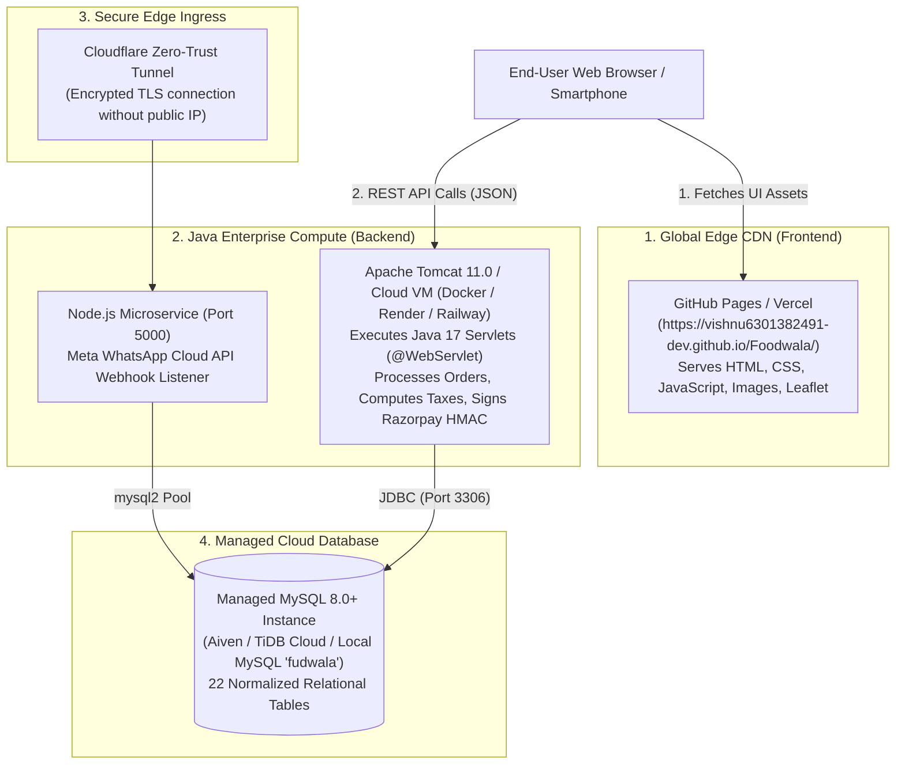

# 11. Git, GitHub, Tomcat & Production Deployment Architecture

## 1. Deployment Architecture Overview

One of the most important concepts to explain to clients, interviewers, and evaluators is **where each layer of FoodWala actually runs**. 

Modern cloud architectures separate the static frontend distribution from dynamic Java compute and persistent relational databases:



---

## 2. GitHub Pages vs Java Backend: The Critical Distinction

> [!IMPORTANT]
> **Essential Client / Interview Concept**:  
> **GitHub Pages is a static file hosting service.** It can only serve static files (HTML, CSS, JavaScript, images, and fonts). GitHub Pages **cannot** execute a Java Virtual Machine (JVM), run Apache Tomcat, compile Java bytecode, or host a MySQL database.

### How FoodWala Handles This Architecturally:
1. **Production Full-Stack Mode**:
   - The frontend is served by Apache Tomcat 11 or an enterprise web server.
   - All AJAX/Fetch calls route to `/FoodWala/api/...` which executes real Java Servlets and queries MySQL.
2. **Cloud Demonstration / GitHub Pages Showcase Mode**:
   - When hosted on GitHub Pages (`https://vishnu6301382491-dev.github.io/Foodwala/`), FoodWala's intelligent frontend adapter (`js/adapters/mockAdapter.js`) detects that the local Java server is unreachable.
   - It seamlessly activates an in-memory client simulation engine that provides full restaurant discovery, cart calculations, and interactive order tracking using verified seed data without crashing!

---

## 3. Deploying the Java Backend on Apache Tomcat 11

### Step 1: Compilation into Bytecode
All 45+ Java classes are compiled into standard Java bytecode (`.class` files) targeted for Java 17:
```powershell
javac -cp "D:\apache-tomcat-11.0.26\lib\servlet-api.jar;D:\FoodWala_Eclipse_Project\src\main\webapp\WEB-INF\lib\*" -d "D:\FoodWala_Eclipse_Project\build\classes" @sources.txt
```

### Step 2: Deployment Structure in Tomcat
Tomcat deploys FoodWala under `D:\apache-tomcat-11.0.26\webapps\Foodwala`:
```
webapps/Foodwala/
├── assets/                  # CSS, vendor libraries (Bootstrap, Leaflet)
├── js/                      # Frontend JavaScript
├── WEB-INF/
│   ├── classes/             # Compiled Java .class files & sms.properties
│   ├── lib/                 # JARs: mysql-connector, bcprov, jbcrypt
│   └── web.xml              # Deployment descriptor (optional in Servlet 5.0+)
└── index.html / home.html   # Entry pages
```

### Step 3: Context Path Mapping (`server.xml`)
In `conf/server.xml`:
```xml
<Context docBase="FoodWala" path="/FoodWala" reloadable="true" source="org.eclipse.jst.jee.server:FoodWala"/>
```

---

## 4. Cloud Database Hosting & Configuration

FoodWala is 100% cloud-agnostic. The database engine connects seamlessly to any managed MySQL instance:

| Cloud Provider | Connection String Syntax |
| :--- | :--- |
| **Localhost** | `jdbc:mysql://localhost:3306/fudwala?useSSL=false` |
| **Aiven Cloud MySQL** | `jdbc:mysql://mysql-foodwala.aivencloud.com:21345/fudwala?sslmode=require` |
| **TiDB Cloud Serverless** | `jdbc:mysql://gateway01.ap-southeast-1.prod.aws.tidbcloud.com:4000/fudwala` |
| **Railway / Render** | `jdbc:mysql://${MYSQLHOST}:${MYSQLPORT}/${MYSQLDATABASE}` |

### Configuration via Environment Variables:
`DBConnection.java` dynamically reads environment variables, ensuring zero hardcoded database passwords:
```bash
export DB_HOST="your-cloud-db-host.com"
export DB_PORT="3306"
export DB_NAME="fudwala"
export DB_USER="admin"
export DB_PASSWORD="YourSecureCloudPassword123"
```

---

## 5. Security & Credentials Isolation (`.gitignore`)

To comply with enterprise security auditing, **passwords, API keys, and private certificates must NEVER be committed to public GitHub repositories**.

FoodWala's `.gitignore` strictly protects sensitive credentials:
```gitignore
# Environment Variables & Secrets (NEVER COMMIT)
.env
*.env
server/.env
sms.properties
src/main/resources/sms.properties
src/main/webapp/sms.properties
src/main/webapp/WEB-INF/classes/sms.properties

# Public Templates (Always Safe to Track)
!.env.example
!sms.properties.example
!src/main/resources/sms.properties.example
```
