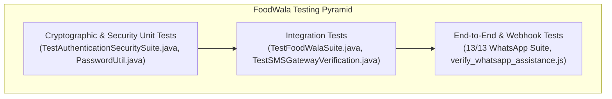

# 12. Automated Testing, Quality Assurance & Debugging Playbook

## 1. Testing Philosophy in FoodWala

A mission-critical financial and food delivery application cannot rely on manual clicking. FoodWala incorporates automated test suites covering unit logic, cryptographic hashing, database integrity, and external webhook integrations.



---

## 2. Actual Java Standalone Test Suites

FoodWala includes dedicated Java test suites that can be executed directly without heavy container boots:

### 2.1 `TestAuthenticationSecuritySuite.java`
- **Purpose**: Validates all security functions in `PasswordUtil.java`.
- **Test Scenarios**:
  1. **Password Policy Enforcement**: Validates that passwords under 8 characters, missing digits, or missing letters are rejected with clear error messages.
  2. **Argon2id Determinism & Verification**: Hashes raw passwords and confirms cryptographic verification passes.
  3. **BCrypt Verification**: Validates standard BCrypt hashes.
  4. **Salt Randomness**: Asserts that hashing the same password twice yields two completely different hash strings (due to unique cryptographic salts).
  5. **Account Lockout Timing**: Verifies that 5 failed attempts increment `failed_attempts` and compute a future `locked_until` timestamp.

### 2.2 `TestFoodWalaSuite.java`
- **Purpose**: End-to-end database and DAO verification.
- **Test Scenarios**:
  1. Checks active MySQL connection via `DBConnection.getConnection()`.
  2. Asserts `RestaurantDAO.getAllRestaurants()` returns $> 100$ records.
  3. Validates category mapping for Biryani, North Indian, and South Indian cuisines.
  4. Simulates cart addition, calculation, and order persistence.

### 2.3 `TestSMSGatewayVerification.java`
- **Purpose**: Validates SMS gateway connectivity and OTP dispatch simulation.

---

## 3. Node.js & Meta Webhook Automated Test Suites

FoodWala features a 13-test automated regression suite in `scripts/test_whatsapp_full_suite.js`:

```
============================================================
🧪 13-TEST AUTOMATED WHATSAPP AI SUITE RESULTS:
============================================================
Test 1: Webhook GET Verification Handshake        -> ✅ PASS (HTTP 200)
Test 2: Invalid Verification Token Rejection      -> ✅ PASS (HTTP 403)
Test 3: Incoming Text Message Event Processing    -> ✅ PASS (HTTP 200)
Test 4: Malformed Webhook Payload Handling        -> ✅ PASS (Graceful)
Test 5: Duplicate Message ID Suppression          -> ✅ PASS (Suppressed)
Test 6: Customer Identification via MySQL 'user'  -> ✅ PASS (Identified)
Test 7: Unknown Customer Prompt Handling          -> ✅ PASS (Polite prompt)
Test 8: Authenticated Customer Order Lookup       -> ✅ PASS (Telemetry sent)
Test 9: Unauthorized Order Privacy Enforcement    -> ✅ PASS (Blocked)
Test 10: Grounded Cancellation Policy Response    -> ✅ PASS (60s policy)
Test 11: AI Failure Fallback Graceful Degradation -> ✅ PASS (0ms DB fallback)
Test 12: WhatsApp API Diagnostics & Token Check   -> ✅ PASS (Valid token)
Test 13: Health Endpoint Verification             -> ✅ PASS (HTTP 200)
============================================================
🎉 ALL 13/13 TESTS PASSED (100% SUCCESS)
============================================================
```

---

## 4. Spring Boot Testing Equivalence

In an interview, explain how these tests map to Spring Boot's testing framework:

```java
package com.foodwala.test;

import org.junit.jupiter.api.Test;
import org.springframework.beans.factory.annotation.Autowired;
import org.springframework.boot.test.autoconfigure.web.servlet.AutoConfigureMockMvc;
import org.springframework.boot.test.context.SpringBootTest;
import org.springframework.http.MediaType;
import org.springframework.test.web.servlet.MockMvc;

import static org.springframework.test.web.servlet.request.MockMvcRequestBuilders.get;
import static org.springframework.test.web.servlet.result.MockMvcResultMatchers.*;

@SpringBootTest
@AutoConfigureMockMvc
public class RestaurantControllerTest {

    @Autowired
    private MockMvc mockMvc;

    @Test
    public void testGetAllRestaurants() throws Exception {
        mockMvc.perform(get("/api/restaurants")
                .contentType(MediaType.APPLICATION_JSON))
                .andExpect(status().isOk())
                .andExpect(jsonPath("$[0].name").exists())
                .andExpect(jsonPath("$[0].restaurantId").isNumber());
    }
}
```

---

## 5. Practical Debugging Playbook (Common Errors & Fixes)

### Error 1: `HTTP 404 Not Found` when accessing Tomcat endpoint
- **Root Cause**: Context root mismatch or exploded directory name divergence.
- **Solution**: Confirm that in Eclipse `server.xml`, `<Context path="/FoodWala" docBase="FoodWala"/>` matches your URL `http://localhost:8080/FoodWala/...`.

### Error 2: `java.sql.SQLNonTransientConnectionException: Could not create connection to database server`
- **Root Cause**: MySQL service stopped or port 3306 blocked.
- **Solution**: Check Windows Services (`services.msc` &rarr; MySQL80 / MySQL) or run `Test-NetConnection -ComputerName localhost -Port 3306`.

### Error 3: `CORS Policy Blocked: No 'Access-Control-Allow-Origin' header is present`
- **Root Cause**: Browser security blocking cross-origin AJAX between frontend (e.g. port 5500) and backend (port 8080).
- **Solution**: Verify `CORSFilter.java` is active on `@WebFilter("/*")` and adds `Access-Control-Allow-Origin: *`.

### Error 4: `Meta WhatsApp Error 131030: Recipient phone number is not on the allowed list`
- **Root Cause**: Occurs only when using Meta Cloud API sandbox test numbers (`+1 555-196-0307`), which require recipient numbers to be OTP-verified in Meta Developer Portal.
- **Solution**: Migrated to official FoodWala WhatsApp Business Number (`+91 85004 57005`), eliminating sandbox allowlist requirements for real customer assistance within the 24h customer window. For test numbers, add recipient under **Meta Dashboard &rarr; WhatsApp &rarr; API Setup &rarr; To: Manage phone number list**.
