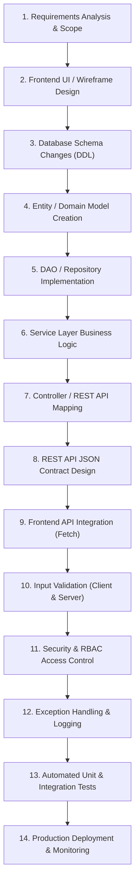

# 14. How to Implement New Features: The 14-Step Full-Stack Playbook

## 1. The 14-Step Software Engineering Workflow

Clients and interviewers frequently ask:  
*"If our business needs a brand new feature tomorrow, what is your exact step-by-step engineering process to implement it?"*

Use this **14-step battle-tested playbook** to demonstrate structured, enterprise-grade engineering thinking:



---

## 2. Walkthrough Example 1: Adding a New Customer Field (`dietary_preference`)

Let's walk through adding a **"Dietary Preference"** field (`VEG`, `NON_VEG`, `VEGAN`, `JAIN`) to the customer profile:

### Step 1: Requirements
Allow customers to save their dietary preference so the restaurant menu automatically pre-filters dishes matching their diet.

### Step 2: Database Schema Update (DDL)
```sql
ALTER TABLE user 
ADD COLUMN dietary_preference VARCHAR(30) DEFAULT 'ALL' 
AFTER address;
```

### Step 3: Domain Model Update (`com.tap.model.User.java`)
```java
// In User.java:
private String dietaryPreference;

public String getDietaryPreference() { return dietaryPreference; }
public void setDietaryPreference(String dietaryPreference) { 
    this.dietaryPreference = dietaryPreference; 
}
```

### Step 4: DAO Layer Update (`com.tap.daoimpl.UserDAOImpl.java`)
```java
// Update SQL string:
private static final String UPDATE_QUERY = 
    "UPDATE user SET username=?, email=?, phone=?, address=?, dietary_preference=? WHERE user_id=?";

// Update PreparedStatement binding:
ps.setString(5, user.getDietaryPreference());
ps.setInt(6, user.getUserId());
```

### Step 5: Controller & REST Endpoint (`com.tap.controller.ProfileController.java`)
```java
// Read parameter from request
String diet = request.getParameter("dietaryPreference");
if (diet != null && isValidDiet(diet)) {
    currentUser.setDietaryPreference(diet);
    userDAO.updateUser(currentUser);
    response.getWriter().write("{\"success\":true,\"message\":\"Preference saved\"}");
}
```

### Step 6: Frontend Integration (`profile.html` & `js/app.min.js`)
```html
<!-- HTML dropdown in profile.html -->
<label class="form-label">Dietary Preference</label>
<select id="dietarySelect" class="form-select">
    <option value="ALL">No Preference</option>
    <option value="VEG">Pure Vegetarian</option>
    <option value="VEGAN">Vegan</option>
    <option value="JAIN">Jain Food</option>
</select>
```
```javascript
// JavaScript in app.min.js:
async function saveDietPreference() {
    const diet = document.getElementById('dietarySelect').value;
    const response = await fetch('/FoodWala/profile', {
        method: 'POST',
        headers: { 'Content-Type': 'application/x-www-form-urlencoded' },
        body: `action=updateDiet&dietaryPreference=${encodeURIComponent(diet)}`
    });
    const result = await response.json();
    if (result.success) showToast('Dietary preference updated!');
}
```

---

## 3. Walkthrough Example 2: Adding a Dynamic Promo Code Engine

### Step 1: Database Tables
```sql
CREATE TABLE coupons (
    coupon_id INT AUTO_INCREMENT PRIMARY KEY,
    code VARCHAR(50) UNIQUE NOT NULL,
    discount_amount DOUBLE NOT NULL,
    min_order_amount DOUBLE NOT NULL,
    expires_at DATETIME NOT NULL,
    is_active BOOLEAN DEFAULT TRUE
);
```

### Step 2: Service Layer Validation Logic (`OrderService.java`)
```java
public double applyCoupon(String couponCode, double subtotal, int userId) {
    Coupon coupon = couponDAO.getByCode(couponCode);
    
    // Validation checks
    if (coupon == null || !coupon.isActive()) {
        throw new IllegalArgumentException("Invalid coupon code.");
    }
    if (new Date().after(coupon.getExpiresAt())) {
        throw new IllegalArgumentException("This coupon has expired.");
    }
    if (subtotal < coupon.getMinOrderAmount()) {
        throw new IllegalArgumentException("Minimum order value of ₹" + coupon.getMinOrderAmount() + " required.");
    }
    if (couponDAO.hasUserRedeemed(userId, coupon.getCouponId())) {
        throw new IllegalArgumentException("You have already used this coupon.");
    }

    return Math.min(coupon.getDiscountAmount(), subtotal);
}
```

---

## 4. Walkthrough Example 3: Adding a New Payment Gateway (Stripe or PayU)

1. **Create Strategy Interface**: `PaymentGatewayService` declaring `createPaymentOrder()` and `verifyWebhook()`.
2. **Implement Gateway Adapter**: `StripePaymentServiceImpl` or `PayUPaymentServiceImpl` using official Java SDKs.
3. **Database Polymorphism**: Store the provider name in `payment.payment_method` (`RAZORPAY`, `STRIPE`, `COD`).
4. **Client Modal**: Dynamically load the chosen payment provider's SDK script in `checkout.html`.
5. **Webhook Receiver**: Expose `/api/payment/stripe/webhook` to handle asynchronous capture events.

---

## 5. Walkthrough Example 4: Adding an Order Status State Transition

To introduce a new status: `FOOD_PREPARING_ON_STOVE`:
1. **Enum Update**: Add `FOOD_PREPARING_ON_STOVE` to the `OrderStatus` enum.
2. **Audit Trail**: Insert record in `order_status_history` capturing timestamp and chef notes.
3. **Frontend Visual Timeline**: Add an illuminated badge in `order-tracking.html` and sound chime.
4. **WhatsApp AI Sync**: Update `whatsappController.js` so customer inquiries receive: *"Your food is currently on the stove at Donne Biryani Mane!"*
