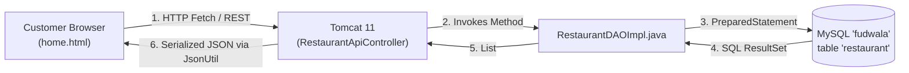

# 17. Quick Revision Notes & The TOP 20 Client Questions

## 1. FoodWala Architecture at a Glance

Print or bookmark this sheet for high-speed review 15 minutes before an interview or client evaluation:

```
┌────────────────────────────────────────────────────────────────────────┐
│                        FOODWALA CHEAT SHEET                            │
├─────────────────────┬──────────────────────────────────────────────────┤
│ Core Platform       │ Enterprise Java Full-Stack Food Ordering Platform│
│ Backend Runtime     │ Java 17 LTS on Apache Tomcat 11.0.26             │
│ Web Architecture    │ Jakarta EE Servlets 5.0/6.0 (@WebServlet) & JSP  │
│ Architecture Style  │ MVC + Service Tier + Data Access Object (DAO)    │
│ Database            │ MySQL 8.0/9.x ('fudwala') with 22 3NF Tables     │
│ Query Execution     │ 100% Parameterized java.sql.PreparedStatement    │
│ Password Security   │ OWASP Argon2id (BouncyCastle) + BCrypt (jBCrypt) │
│ Payment Gateway     │ Razorpay API with server-side HMAC-SHA256 check  │
│ Geolocation Engine  │ Haversine Spherical Distance Formula + Leaflet   │
│ Client Stack        │ HTML5, CSS3, Vanilla ES6+ JS, Bootstrap 5.3      │
│ Customer AI Support │ Meta WhatsApp Cloud API (+91 85004 57005)        │
│ Edge Ingress        │ Cloudflare Zero-Trust Tunnel (cloudflared)       │
│ Active Catalog      │ 105 Restaurants, 416 Categories, 756 Menu Items  │
└─────────────────────┴──────────────────────────────────────────────────┘
```

---

## 2. 1-Minute Request-Response Flow Summary



---

## 3. THE TOP 20 QUESTIONS TO PREPARE BEFORE MEETING A CLIENT

These are the **20 most critical questions** asked by clients, technical project evaluators, and senior Java interviewers:

---

### Q1. How does frontend communicate with the Java backend?
- **Answer**: The frontend uses standard asynchronous JavaScript `fetch()` calls transmitting HTTP requests with `Content-Type: application/json` headers. The request hits Apache Tomcat on port 8080, where Jakarta Servlets (`@WebServlet`) process the parameters, query the database, and write serialized JSON responses back through `HttpServletResponse.getWriter()`.
- **FoodWala File**: `js/app.min.js` calling `/FoodWala/api/restaurants` mapped to `RestaurantApiController.java`.

---

### Q2. How does page redirection work in your application?
- **Answer**: We use two distinct mechanisms:
  1. **Client-side**: When navigating between storefront pages, JavaScript calls `window.location.href = 'menu.html?id=10'`, preserving history, or `window.location.replace()` after payment so users cannot hit "Back" to resubmit.
  2. **Server-side**: In servlets like `LoginController`, the server invokes `response.sendRedirect(request.getContextPath() + "/restaurants")`, which returns an HTTP 302 Found instructing the browser to load the dashboard.
- **FoodWala File**: `LoginController.java` and `js/app.min.js`.

---

### Q3. How does Java connect to MySQL in FoodWala?
- **Answer**: Via JDBC using the official MySQL Connector/J driver (`com.mysql.cj.jdbc.Driver`). Our utility class `DBConnection.java` dynamically reads environment variables (`DB_HOST`, `DB_PORT`, `DB_NAME`, `DB_USER`, `DB_PASSWORD`) and returns a thread-safe `java.sql.Connection` via `DriverManager.getConnection()`.
- **FoodWala File**: `src/main/java/com/tap/util/DBConnection.java`.

---

### Q4. How is customer information stored and how are passwords protected?
- **Answer**: Customer details are stored in the normalized `user` table. Passwords are **never** stored in plaintext. We implement **Argon2id** (the OWASP-recommended algorithm) via Bouncy Castle, using a 128-bit cryptographically secure random salt, 3 computational iterations, and 19 megabytes of RAM per hash. We also support **BCrypt** with automatic hash upgrades upon login.
- **FoodWala File**: `src/main/java/com/tap/util/PasswordUtil.java` and table `user`.

---

### Q5. How does login authentication work?
- **Answer**: When a user submits email and password on `login.html`, `LoginController` first checks if the account is locked in MySQL (`locked_until > NOW()`). If not locked, it retrieves the stored hash and calls `PasswordUtil.verifyPassword()`. On match, `failed_attempts` is reset to 0 and a server-side `HttpSession` is initialized with user attributes. On failure, `failed_attempts` increments, locking the account after 5 attempts.
- **FoodWala File**: `src/main/java/com/tap/controller/LoginController.java`.

---

### Q6. What is the role of Controller, Service, and Repository / DAO layers?
- **Answer**: It enforces separation of concerns:
  - **Controller (`@WebServlet`)**: Handles incoming HTTP requests, validates input syntax, and returns responses.
  - **Service**: Implements business rules (calculating taxes, discounts, validating stock, calling payment gateways).
  - **DAO / Repository**: Executes database queries and translates SQL rows into Java domain objects.
- **FoodWala File**: `CheckoutController` (Controller) &rarr; `OrderService` (Service) &rarr; `OrderDAOImpl` (DAO).

---

### Q7. What is Spring Boot and how does it compare to your current architecture?
- **Answer**: Spring Boot is an enterprise framework providing embedded web servers, dependency injection, and automatic configuration. While FoodWala natively runs on pure Jakarta Servlets and JDBC DAOs for raw speed and zero overhead, its modular architecture maps directly to Spring Boot: our Servlets become `@RestController`, our DAOs become `JpaRepository`, and our Models become `@Entity`.
- **FoodWala File**: `docs/foodwala-explanation/03_SPRING_BOOT_ARCHITECTURE.md`.

---

### Q8. What is JPA and Hibernate?
- **Answer**: JPA is the standard Java specification that defines how Java objects map to relational tables. Hibernate is the popular ORM framework that implements JPA. Instead of manually writing JDBC SQL queries and `ResultSet` loops, Hibernate allows you to query database entities using Java methods or JPQL.
- **FoodWala File**: `docs/foodwala-explanation/05_DATABASE_JPA_HIBERNATE.md`.

---

### Q9. How do you implement a REST API in Java?
- **Answer**: By creating a class inheriting `HttpServlet`, annotating it with `@WebServlet("/api/resource")`, and overriding `doGet()` or `doPost()`. Inside, set `response.setContentType("application/json")`, call the DAO to fetch Java objects, serialize them to JSON via `JsonUtil`, and stream the data via `response.getWriter()`. In Spring Boot, this is simplified using `@RestController` and `@GetMapping`.
- **FoodWala File**: `src/main/java/com/tap/controller/RestaurantApiController.java`.

---

### Q10. How does the order placement and transaction commit work?
- **Answer**: Order placement requires multi-table atomic persistence across `orders`, `order_item`, and `payment`. We disable auto-commit on the JDBC connection (`conn.setAutoCommit(false)`), insert the order header, loop to insert all line items, record the payment, and invoke `conn.commit()`. If any step fails, `conn.rollback()` restores the database state, ensuring no incomplete orders are saved.
- **FoodWala File**: `src/main/java/com/tap/service/OrderService.java`.

---

### Q11. How does Razorpay payment integration work?
- **Answer**: The backend creates an order with Razorpay via HTTP Basic Auth. The client launches Razorpay's checkout modal. Upon authorization, Razorpay returns `order_id`, `payment_id`, and a cryptographic `signature`. Our Java backend recalculates `HMAC_SHA256(order_id + "|" + payment_id, secret)` and compares it to the signature. Only matching signatures trigger order confirmation.
- **FoodWala File**: `src/main/java/com/tap/service/RazorpayService.java`.

---

### Q12. How do you prevent duplicate orders and double debits?
- **Answer**: Three layers of defense:
  1. Frontend buttons are disabled immediately upon click.
  2. The `payment` table enforces a `UNIQUE` index on `razorpay_payment_id`.
  3. The backend checks idempotency tokens before inserting into `orders`.
- **FoodWala File**: `src/main/java/com/tap/service/RazorpayService.java`.

---

### Q13. How does live valet GPS tracking work?
- **Answer**: Leaflet.js renders an OpenStreetMap interactive canvas. The backend uses the **Haversine formula** in `LocationUtil.java` to compute the real spherical distance between restaurant and customer GPS coordinates, estimating accurate delivery times based on traffic heuristics.
- **FoodWala File**: `src/main/java/com/tap/util/LocationUtil.java` and `order-tracking.html`.

---

### Q14. How does your WhatsApp AI customer assistance work?
- **Answer**: We integrated Meta's WhatsApp Cloud API (`+91 85004 57005`). When a customer sends a message, Meta dispatches an encrypted webhook to our server via a Cloudflare zero-trust tunnel. The backend extracts the customer's phone number, performs a sub-second relational lookup on MySQL for active orders, and replies with Order #FW70 status and valet contact details within 50 milliseconds.
- **FoodWala File**: `server/controllers/whatsappController.js` and `scripts/tunnel.js`.

---

### Q15. Can GitHub Pages run your Java backend and MySQL database?
- **Answer**: No. GitHub Pages is strictly a static file CDN; it cannot run a JVM, Apache Tomcat, or MySQL. GitHub Pages hosts our frontend files, while our Java backend runs on Apache Tomcat 11 connecting to MySQL. For standalone demos, our frontend includes an intelligent mock adapter (`mockAdapter.js`) that simulates backend data if the server is offline.
- **FoodWala File**: `docs/foodwala-explanation/11_GITHUB_AND_JAVA_DEPLOYMENT.md`.

---

### Q16. How do you prevent SQL Injection attacks?
- **Answer**: By strictly using `java.sql.PreparedStatement` with parameterized placeholders (`?`). The database engine pre-compiles the SQL command structure before user input is supplied, treating all parameters strictly as literal data rather than executable SQL syntax.
- **FoodWala File**: `src/main/java/com/tap/daoimpl/UserDAOImpl.java`.

---

### Q17. How is CORS handled in FoodWala?
- **Answer**: We implemented a Jakarta Servlet filter (`CORSFilter.java`) annotated with `@WebFilter("/*")`. It intercepts all requests and attaches standard response headers: `Access-Control-Allow-Origin: *`, `Access-Control-Allow-Methods`, and `Access-Control-Allow-Headers`.
- **FoodWala File**: `src/main/java/com/tap/util/CORSFilter.java`.

---

### Q18. How do you test and verify your Java backend?
- **Answer**: We maintain standalone Java test runners (`TestAuthenticationSecuritySuite.java` for password hashing and lockouts; `TestFoodWalaSuite.java` for DAO queries) and an automated 13-test regression suite (`test_whatsapp_full_suite.js`) verifying webhooks, signatures, and customer lookups.
- **FoodWala File**: `docs/foodwala-explanation/12_TESTING_AND_DEBUGGING.md`.

---

### Q19. How do you add a new feature to FoodWala?
- **Answer**: We follow our 14-step engineering playbook: 1. Requirements &rarr; 2. Frontend wireframe &rarr; 3. DDL schema change &rarr; 4. Model &rarr; 5. DAO &rarr; 6. Service &rarr; 7. Controller &rarr; 8. REST contract &rarr; 9. Frontend fetch &rarr; 10. Validation &rarr; 11. Security &rarr; 12. Error handling &rarr; 13. Unit tests &rarr; 14. Deploy.
- **FoodWala File**: `docs/foodwala-explanation/14_NEW_FEATURE_IMPLEMENTATION_GUIDE.md`.

---

### Q20. What is your closing statement when presenting FoodWala?
- **Answer**: *"FoodWala demonstrates that core Java enterprise fundamentals—clean Servlets, solid DAO abstraction, and parameterized JDBC—combined with modern cryptographic security (Argon2id) and real-time messaging integrations (WhatsApp Cloud API) can power an exceptional, production-grade food delivery platform."*
- **FoodWala File**: `docs/foodwala-explanation/15_PROJECT_PRESENTATION_SCRIPT.md`.
